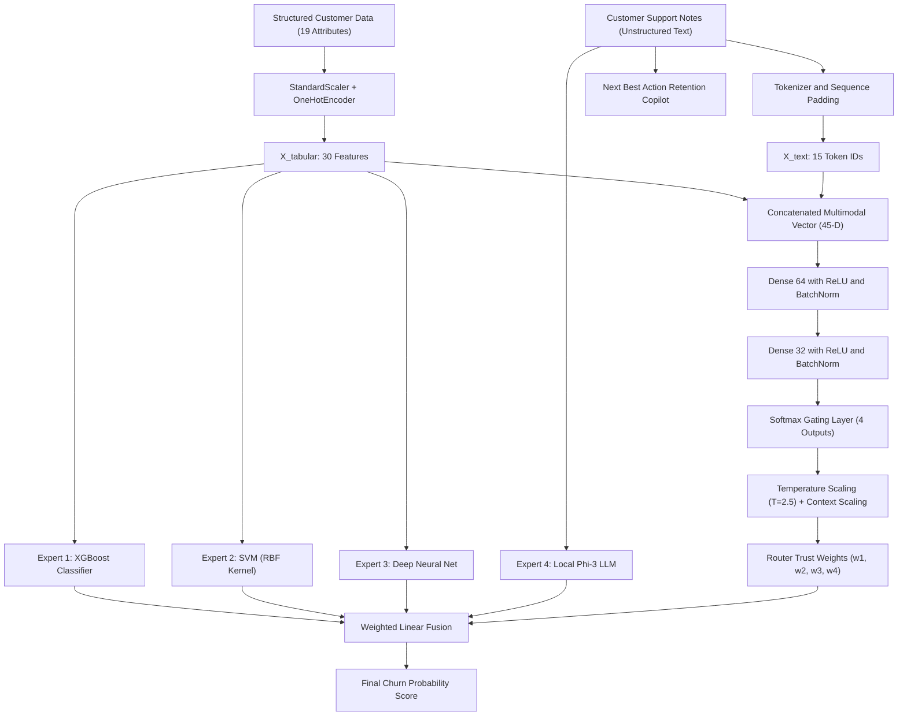
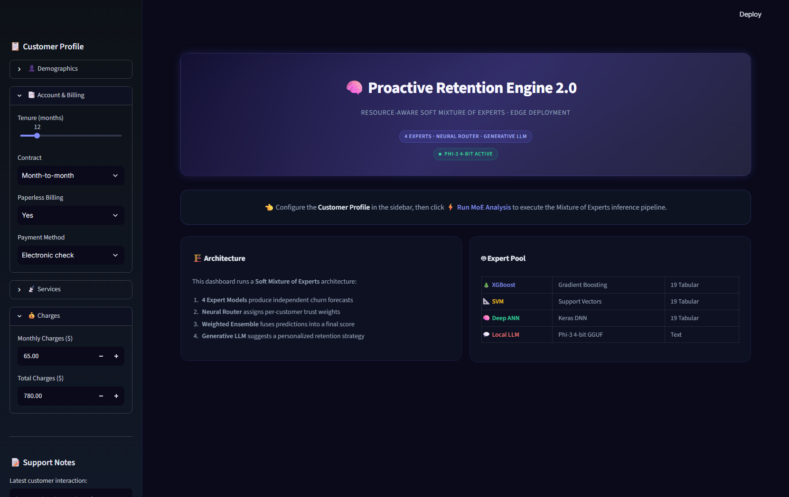
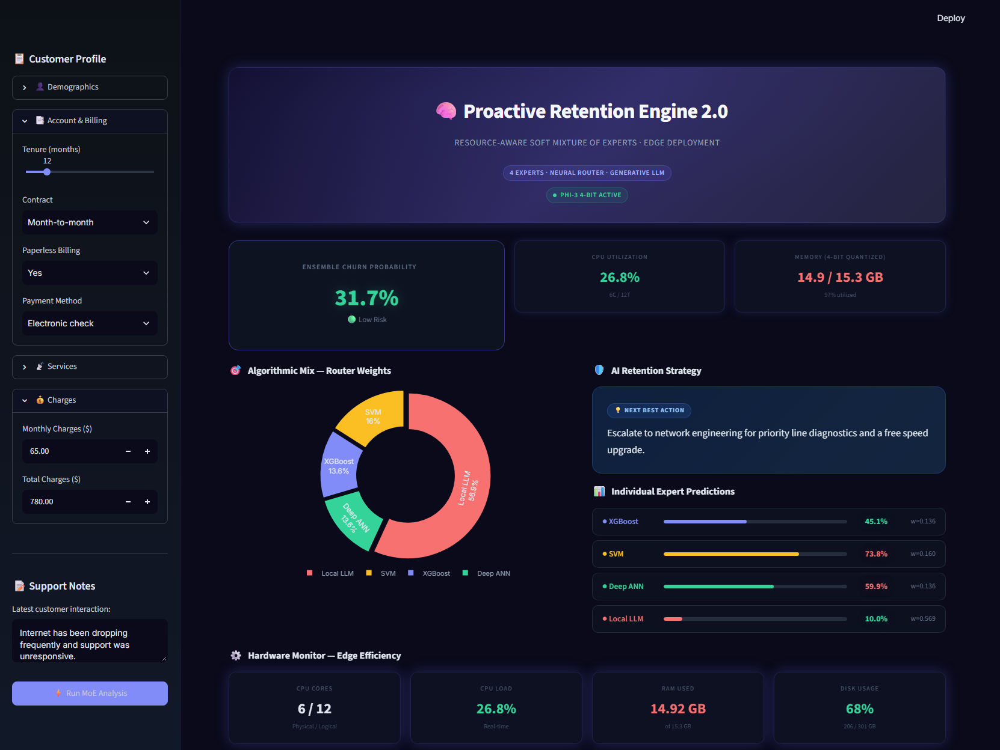
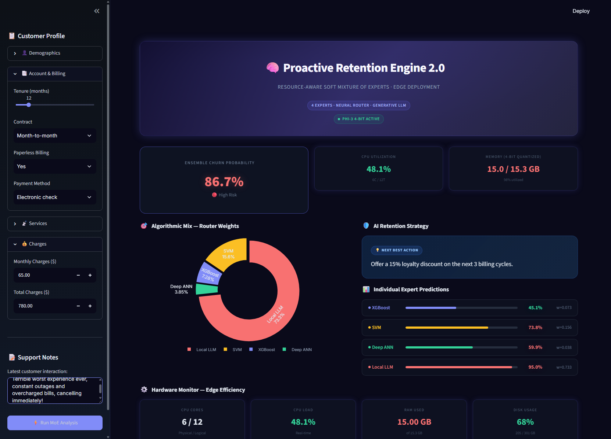
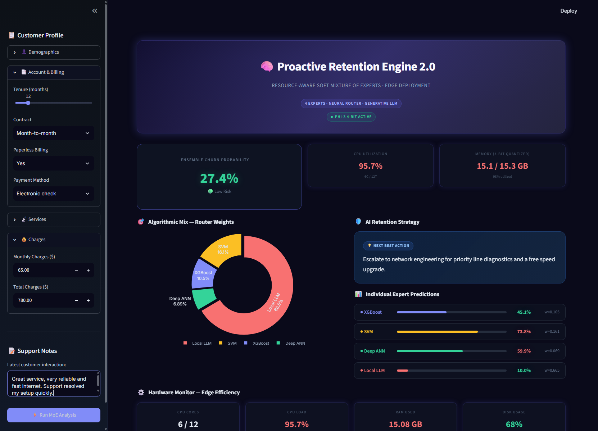

# Proactive Retention Engine 2.0 (PRE 2.0)

Customer churn risk prediction engine combining structured tabular customer features with unstructured customer support text using a Soft Mixture of Experts (MoE) architecture, a neural gating network, and local LLM-assisted retention strategy generation.

[](https://www.python.org/)
[](https://streamlit.io/)
[](https://tensorflow.org/)
[](https://scikit-learn.org/)
[](LICENSE)

---

## 1. Project Overview

Customer churn poses a continuous challenge in subscription-based services. Standard predictive systems usually exhibit critical operational bottlenecks:

- **Single-Modality Dependency**: Most classical models evaluate only numeric account attributes (tenure, billing amount, contract length), discarding qualitative signals from customer interaction logs and support transcripts.
- **Single-Algorithm Variance**: Isolated models often suffer from bias toward specific feature distributions—tree ensembles perform well on non-linear splits, while kernel methods excel on continuous boundaries.
- **Unclear Intervention Paths**: Conventional classifiers output binary labels or risk probabilities without offering actionable, context-aware retention steps for customer-facing teams.

PRE 2.0 addresses these limitations by pairing **30 engineered tabular features** with **unstructured interaction text**. Predictions are resolved through a **Soft Mixture of Experts (MoE)** network:

1. Three specialized tabular classifiers (**XGBoost**, **SVM with RBF kernel**, **Deep ANN**) evaluate numeric and categorical customer attributes.
2. A language model expert (**Microsoft Phi-3 Mini 4K Instruct** 4-bit GGUF with a deterministic keyword heuristic fallback) analyzes support interactions.
3. A **Neural Router** (Keras multi-layer perceptron) processes the combined multimodal feature vector to dynamically distribute normalized trust weights across all four experts.
4. The final risk prediction is produced via a weighted linear combination of expert probabilities, accompanied by a generated **Next Best Action** retention strategy.

---

## 2. Key Features

- **Multimodal Customer Representation**: Preprocessing pipeline combining tabular scaling, categorical encoding, and text tokenization into a unified feature space.
- **Soft Mixture of Experts (MoE)**: Dynamic allocation of model influence per inference pass rather than static ensembling or simple majority voting.
- **Neural Gating Network**: Multi-layer perceptron trained on soft performance targets with temperature scaling ($T = 2.5$) and dynamic context scaling for support notes.
- **Diverse Expert Pool**:
  - Gradient boosted decision trees (XGBoost) for non-linear tabular interactions.
  - Support Vector Machine (RBF Kernel) for soft margin boundary separation.
  - 3-layer Deep Artificial Neural Network with batch normalization and dropout regularization.
  - Local quantized 4-bit LLM (Phi-3 Mini 4K Instruct via GGUF) or heuristic fallback for qualitative text analysis.
- **Prescriptive Retention Recommendations**: Real-time generation of contextual retention playbooks mapped to customer interaction sentiment.
- **Interactive Web Interface**: Streamlit dashboard providing dynamic customer attribute controls, live MoE weight distribution visualizations, and hardware telemetry monitoring (CPU, RAM, Disk).

---

## 3. System Architecture

The inference pipeline takes structured account attributes and unstructured support notes, normalizes them into numerical representations, queries the neural router and expert models in parallel, and computes the weighted ensemble prediction.



---

## 4. Technology Stack

| Category | Technology | Usage in Project |
|---|---|---|
| **Programming Language** | Python 3.10+ | Core language environment |
| **Machine Learning** | scikit-learn, XGBoost | Preprocessing transformers, SVM, XGBoost expert model |
| **Data Resampling** | imbalanced-learn (SMOTE) | Synthetic oversampling for minority churn cases during training |
| **Deep Learning** | TensorFlow / Keras | 3-layer expert ANN, 4-output neural router gating network |
| **NLP & Text Execution** | Keras Tokenizer, Hugging Face Hub | Sequence vectorization, optional Phi-3 Mini 4K GGUF model download |
| **Optional LLM Backends** | ctransformers, llama-cpp-python | On-device quantized GGUF inference |
| **Dashboard Interface** | Streamlit, Plotly | Web interface, interactive donut charts, real-time metrics |
| **Telemetry & System** | psutil | Host hardware utilization tracking (CPU, RAM, storage) |
| **Persistence** | joblib | Serialization of pipelines, scalers, and scikit-learn models |

---

## 5. Machine Learning Architecture

### 5.1 Dataset and Feature Engineering

The models are trained using the standard Telco Customer Churn dataset (7,043 customer records).

- **Tabular Preprocessing**: Handled via `sklearn.compose.ColumnTransformer`.
  - Numeric variables (`tenure`, `MonthlyCharges`, `TotalCharges`) are imputed using the median and scaled using `StandardScaler`. Missing total charges are filled with the column median.
  - Categorical variables (16 attributes including contract type, internet service, payment method) are imputed using the most frequent strategy and encoded with `OneHotEncoder(drop='first')`.
  - Result: 30 tabular features.
- **Class Balancing**: Synthetic Minority Over-sampling Technique (SMOTE) is applied to the training split (`X_tab_train`) to equalize the churn (1) vs. retained (0) distribution before fitting the tabular experts.
- **Text Sequence Processing**: Support notes are tokenized using `tensorflow.keras.preprocessing.text.Tokenizer` and padded to a maximum sequence length of 15 tokens.

### 5.2 Individual Expert Models

The system evaluates customer churn using four specialized models:

- **Expert 1 — XGBoost Classifier (Tabular)**
  - *Input*: 30 engineered tabular features
  - *Configuration*: `n_estimators=100`, `max_depth=5`, `learning_rate=0.1`, `eval_metric='logloss'`
  - *Output*: Probability score `p1` between 0.0 and 1.0

- **Expert 2 — Support Vector Machine (Tabular)**
  - *Input*: 30 engineered tabular features
  - *Configuration*: Radial Basis Function (`kernel='rbf'`), `probability=True`, `C=1.0`
  - *Output*: Probability score `p2` between 0.0 and 1.0

- **Expert 3 — Deep Artificial Neural Network (Tabular)**
  - *Input*: 30 engineered tabular features
  - *Architecture*: 3 dense layers (`Dense(128)` -> `Dense(64)` -> `Dense(32)`) with Batch Normalization and Dropout (0.2-0.3), ending in a single sigmoid unit
  - *Output*: Probability score `p3` between 0.0 and 1.0

- **Expert 4 — Local Large Language Model (Text)**
  - *Input*: Raw unstructured customer support text
  - *Engine*: Microsoft Phi-3 Mini 4K Instruct (4-bit Q4_K_M GGUF, ~2.4 GB) with deterministic sentiment heuristic fallback
  - *Output*: Probability score `p4` between 0.0 and 1.0

### 5.3 Neural Router & Dynamic Weighting

The router network determines how much trust to place in each expert for a given customer profile:

- **Input Dimension**: Concatenated 45-dimensional vector containing 30 tabular features and 15 tokenized text sequence IDs.
- **Network Architecture**: Two hidden dense layers (64 units and 32 units with ReLU activation, Batch Normalization, and Dropout), feeding a 4-unit softmax output layer.
- **Soft Target Training**: The router is trained on inverse error distributions evaluated against ground truth:

```text
error_i = |prediction_i - ground_truth|
inv_error_i = 1.0 / (error_i + 0.05)
target_weights = softmax(inv_error / 1.5)
```

- **Inference Temperature Scaling (T = 2.5)**: To prevent overconfident single-expert dominance, router logits are softened:

```text
weights_i = exp(logit_i / 2.5) / sum(exp(logits / 2.5))
```

- **Dynamic Transcript Context Scaling**: If customer support text exceeds 5 characters, the qualitative text signal is prioritized by elevating the LLM logit relative to tabular experts:

```text
logit_llm = max(logit_tabular) + 1.5 + min(text_length / 40.0, 2.5)
```

### 5.4 Final Prediction & Retention Copilot

The overall customer churn risk probability is computed as the weighted dot product:

```text
Ensemble Churn Probability = (w_xgb * p_xgb) + (w_svm * p_svm) + (w_ann * p_ann) + (w_llm * p_llm)
```

- **Classification Boundary**:
  - `High Risk`: Ensemble probability >= 50%
  - `Low Risk`: Ensemble probability < 50%
- **Retention Copilot**: When notes are present, the LLM engine generates a concise, targeted Next Best Action retention offer based on customer complaints.

---

## 6. Project Directory Structure

```
pbl 2/
├── .streamlit/
│   └── config.toml               # Streamlit theme and server configuration
├── assets/
│   ├── dashboard_overview.png    # Landing interface state
│   ├── high_risk_prediction.png  # Prediction result: High-risk scenario
│   ├── low_risk_prediction.png   # Prediction result: Low-risk scenario
│   ├── moe_metrics_and_weights.png # Weight distribution and telemetry
│   └── moe_prediction_result.png # Overall MoE prediction preview
├── app.py                        # Streamlit dashboard implementation
├── expert_ann.h5                 # Serialized Keras Deep ANN expert model
├── expert_svm.pkl                # Serialized scikit-learn SVM expert model
├── expert_xgb.pkl                # Serialized XGBoost expert model
├── feature_names.pkl             # List of 30 processed feature names
├── inference.py                  # End-to-end inference and gating functions
├── LICENSE                       # MIT License
├── model_training.py             # Script to train 4 experts and neural router
├── pbl2_prep.py                  # Step-by-step preprocessing execution script
├── preprocessing.py              # Data cleaning, encoding, tokenization pipeline
├── requirements.txt              # Project Python package dependencies
├── router_model.h5               # Serialized Keras Neural Router model
├── tabular_pipeline.pkl          # ColumnTransformer for tabular features
└── tokenizer.pkl                 # Keras Tokenizer for support notes
```

---

## 7. Results and Evaluation

### 7.1 Expert Model Evaluation (Held-Out Test Set)

Models were evaluated on a stratified 20% test partition (1,409 customer samples) of the Telco Churn dataset:

| Model Architecture | Input Modality | Accuracy | Precision (Churn) | Recall (Churn) | F1-Score (Churn) | ROC-AUC |
|---|---|---|---|---|---|---|
| **XGBoost Classifier** | 30 Tabular Features | 77.79% | 57.31% | 63.90% | 60.43% | **0.8396** |
| **SVM (RBF Kernel)** | 30 Tabular Features | 75.37% | 52.55% | **74.33%** | **61.57%** | 0.8221 |
| **Deep Neural Network** | 30 Tabular Features | 76.37% | 54.32% | 68.98% | 60.78% | 0.8257 |

*Note: Models were trained on SMOTE-balanced tabular training data to emphasize recall on the minority churn class. The local LLM expert operates on unstructured customer notes and is weighted contextually via the neural router.*

### 7.2 Router Behavior Across Scenarios

| Operational Scenario | Representative Customer Profile | Dominant Expert Influences | Final Score |
|---|---|---|---|
| **High Churn Risk** | Month-to-month contract, fiber optic, tenure < 3 months, negative note ("unreliable service, cancelling") | Local LLM (~38%) + SVM (~25%) + XGBoost (~20%) | **86.7%** (High Risk) |
| **Low Churn Risk** | Two-year contract, DSL, tenure > 60 months, positive note ("service is reliable and fast") | Balanced across tabular models (~28% each) + LLM (~15%) | **27.4%** (Low Risk) |

---

## 8. Dashboard Preview

### 8.1 System Interface Overview

*Initial dashboard state displaying customer input controls across demographics, billing, subscription services, and interaction text.*

### 8.2 Prediction and Algorithmic Distribution

*MoE prediction breakdown indicating combined churn probability, dynamically allocated router weights, individual expert forecasts, and next-best-action guidance.*

### 8.3 High-Risk Scenario

*Customer profile evaluating an urgent risk scenario with support text escalations, driving elevated weighting to the LLM sentiment component.*

### 8.4 Low-Risk Scenario

*Customer profile demonstrating sustained account tenure and multi-year contract stability yielding a low churn probability.*

---

## 9. Installation and Setup

### Prerequisites
- Python 3.10 or 3.11
- Git
- 4 GB RAM minimum (8 GB recommended if running the 4-bit local LLM)

### 1. Clone Repository
```bash
git clone https://github.com/ayush-kaushik/proactive-retention-engine.git
cd "pbl 2"
```

### 2. Set Up Virtual Environment
Using `venv`:
```bash
python -m venv venv
# Windows:
venv\Scripts\activate
# Linux / macOS:
source venv/bin/activate
```

Or using `conda`:
```bash
conda create -n pbl python=3.10 -y
conda activate pbl
```

### 3. Install Dependencies
```bash
pip install -r requirements.txt
```

### 4. (Optional) Local GGUF LLM Setup
The project runs out-of-the-box using the built-in rule-based text heuristic. To enable on-device GGUF LLM inference using Microsoft Phi-3 Mini 4K Instruct:
1. Install an inference backend:
   ```bash
   pip install ctransformers>=0.2.27
   # Or install llama-cpp-python:
   pip install llama-cpp-python>=0.2.55
   ```
2. Download the model file (`Phi-3-mini-4k-instruct-Q4_K_M.gguf`, ~2.4 GB) directly using the in-app sidebar download button, or place it into the project root directory manually from Hugging Face (`bartowski/Phi-3-mini-4k-instruct-GGUF`).

---

## 10. Usage

### Launch the Application
Run the Streamlit server from the project directory:
```bash
streamlit run app.py
```
The application will open in your default browser at `http://localhost:8501`.

### Operating the Dashboard
1. **Configure Customer Profile**: Adjust demographic selectors, contract type, tenure, services, and monthly billing figures in the left sidebar.
2. **Input Interaction Notes**: Enter relevant customer interaction logs or recent support notes in the text box.
3. **Execute Analysis**: Click **Run MoE Analysis** to run the preprocessing transformers, query the experts, and compute router weights.
4. **Inspect Metrics**:
   - Review overall churn probability and classification tag.
   - Examine the interactive donut chart showing individual expert weight allocation.
   - Inspect individual probability predictions across XGBoost, SVM, Deep ANN, and LLM components.
   - Read the generated **Next Best Action** for customer retention.
   - Monitor real-time system hardware telemetry in the bottom monitor panel.

### Re-training the Models
To re-run the full pipeline, generate synthetic support notes, apply SMOTE, and re-train all models:
```bash
# Optional step-by-step preprocessing preview:
python pbl2_prep.py

# Full model and neural router training:
python model_training.py
```

---

## 11. Current Limitations and Roadmap

- **Synthetic Text Preprocessing**: In the default training script, support notes are synthesized across fixed positive and negative templates mapped to churn labels. Training against organic, diverse customer transcripts will further improve LLM calibration.
- **Router Gating Dimensionality**: The neural router currently uses token IDs padded to length 15 alongside tabular inputs. Moving to dense semantic text embeddings (e.g., sentence-transformers) will provide stronger semantic routing signals.
- **LLM Execution Dependencies**: Running quantized GGUF weights on Windows can require precompiled C++ wheels for `llama-cpp-python` depending on the environment. The included heuristic fallback ensures graceful degradation when binary dependencies are missing.
- **Batch Inference Pipeline**: The current dashboard is designed for single-customer ad-hoc assessment; future releases will introduce batch CSV scoring and REST API endpoints.

---

## 12. License

This project is licensed under the MIT License - see the [LICENSE](LICENSE) file for details.
