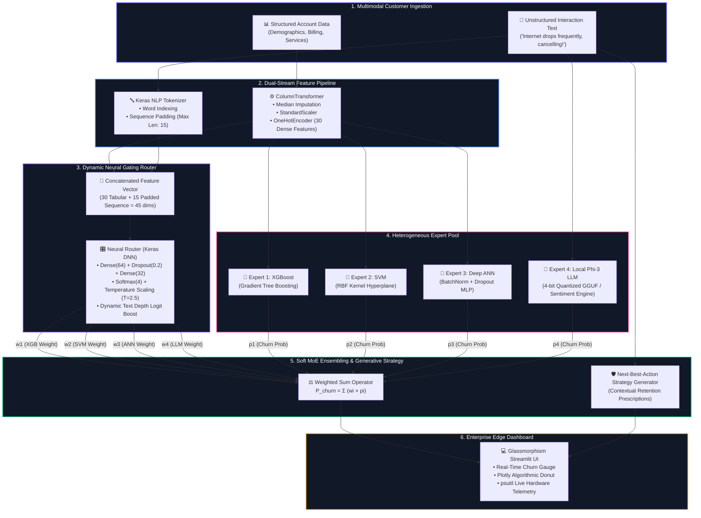

# 🧠 Proactive Retention Engine 2.0 (PRE 2.0)
### *Resource-Aware Soft Mixture of Experts (MoE) · Edge-Deployed Churn Intelligence*

<div align="center">

[](https://www.python.org/)
[](https://streamlit.io/)
[](https://tensorflow.org/)
[](https://scikit-learn.org/)
[](https://xgboost.readthedocs.io/)
[](https://huggingface.co/bartowski/Phi-3-mini-4k-instruct-GGUF)
[](LICENSE)

</div>

---

## 📖 Quick Links

- [🎯 Problem Statement & Solution](#-problem-statement--solution)
- [🏗️ System Architecture & Workflow](#️-system-architecture--workflow)
- [🤖 The 4-Expert Pool & Neural Router](#-the-4-expert-pool--neural-router)
- [🖥️ Interactive Dashboard Walkthrough](#️-interactive-dashboard-walkthrough)
- [📊 Dataset & Engineering Pipeline](#-dataset--engineering-pipeline)
- [⚡ Edge Telemetry & Hardware Efficiency](#-edge-telemetry--hardware-efficiency)
- [📁 Project Structure](#-project-structure)
- [🚀 Quickstart Guide](#-quickstart-guide)
- [🧪 Verification & Sample Output](#-verification--sample-output)
- [❓ Frequently Asked Questions (FAQ)](#-frequently-asked-questions-faq)
- [📜 License & Acknowledgments](#-license--acknowledgments)

---

## 🎯 Problem Statement & Solution

### ⚠️ The Industry Problem
Customer churn costs telecommunications and subscription-based companies billions annually. Traditional retention solutions suffer from two critical architectural bottlenecks:
1. **Tabular Blindness**: Classic statistical models (e.g., Logistic Regression, standard Decision Trees) only analyze numerical metrics (tenure, monthly charges, contract type), remaining completely oblivious to qualitative customer dissatisfaction expressed in support tickets and conversation logs.
2. **Cloud LLM Bottlenecks**: Deploying massive cloud-hosted LLMs (e.g., GPT-4) for every incoming customer event is cost-prohibitive, induces high network latency, violates strict on-premise data privacy rules, and fails to rigorously evaluate structured financial columns.

### 💡 The PRE 2.0 Solution
**Proactive Retention Engine 2.0 (PRE 2.0)** introduces an edge-optimized **Soft Mixture of Experts (MoE)** architecture that:
- **Fuses Multimodal Inputs**: Merges 19 structured account attributes with unstructured natural language customer support transcripts.
- **Dynamically Routes Inference**: A lightweight **Neural Gating Router** calculates real-time credibility weights for each model based on the unique customer profile and text depth.
- **Deploys on Constrained Edge Hardware**: Powered by a 4-bit quantized local LLM (**Microsoft Phi-3 Mini 4K Instruct**), the engine executes locally on commodity CPUs without cloud API dependencies.
- **Prescribes Actionable Interventions**: Generates an automated **"Next Best Action"** retention strategy to empower support agents with tailored retention offers before the customer cancels.

---

## 🏗️ System Architecture & Workflow

The architecture follows a modular, end-to-end dataflow combining tabular transformation, text tokenization, neural gating, multi-expert scoring, and generative retention planning:



---

## 🤖 The 4-Expert Pool & Neural Router

| Model Component | Architecture / Underlying Method | Modality | Role & Core Strength |
| :--- | :--- | :--- | :--- |
| **Expert 1: XGBoost** | Gradient Boosted Decision Trees (`n_estimators=100`, `max_depth=5`, `lr=0.1`) | Tabular (30 features) | Captures non-linear tabular split thresholds, contract duration flags, and charge ratios. |
| **Expert 2: SVM** | Support Vector Classifier with Radial Basis Function (`RBF` Kernel) | Tabular (30 features) | Maximizes classification margins in normalized feature spaces; robust to small localized anomalies. |
| **Expert 3: Deep ANN** | Multi-Layer Perceptron (`Dense 128` → `BatchNorm` → `Dropout` → `Dense 64` → `Dense 32` → `Sigmoid`) | Tabular (30 features) | High-capacity representation learning capable of identifying cross-feature latent representations. |
| **Expert 4: Local LLM** | Microsoft **Phi-3 Mini 4K Instruct** (4-bit `Q4_K_M` GGUF, 3.8B params) + Heuristic Fallback | Unstructured Text | Extracts nuanced semantic frustration, cancellation threats, technician complaints, and hidden churn flags. |
| **Neural Router** | Keras Functional Network (`Input(45)` → `Dense(64)` → `Dropout` → `Dense(32)` → `Softmax(4)`) | Multimodal (Tabular + Text) | Dynamically learns per-customer trust distributions: $\sum_{i=1}^4 w_i = 1.0$. |

### 🎛️ Mathematical Formulation of the Gating Router
To avoid the network collapsing into an overconfident hard switch (e.g. $1.0$ vs $0.0$), PRE 2.0 applies **Softmax Temperature Scaling**:

$$\hat{w}_i = \frac{\exp(z_i / T)}{\sum_{j=1}^{4} \exp(z_j / T)}, \quad \text{where } T = 2.5$$

When meaningful customer notes are provided, a **Dynamic Text Depth Boost** scales the LLM logit relative to the top tabular model:

$$z_{\text{LLM}} = \max(z_{\text{tabular}}) + 1.5 + \left(\frac{\min(\text{length}(\text{notes}), 100)}{40}\right)$$

---

## 🖥️ Interactive Dashboard Walkthrough

The production dashboard is built using **Streamlit** styled with custom **Glassmorphism CSS** (`#0a0a1a` dark-mode backdrop, blur filters, and glowing status borders):

<div align="center">
  
</div>

### Key Dashboard Modules:
1. **Collapsible Customer Profiler**:
   - **👤 Demographics**: Gender, Senior Citizen status, Partner, Dependents.
   - **📑 Account & Billing**: Tenure slider (0–72 months), Contract duration (Month-to-month, 1-yr, 2-yr), Paperless billing, Payment method.
   - **📡 Subscribed Services**: Internet type (Fiber optic, DSL, None), Online Security, Device Protection, Streaming TV/Movies.
   - **💰 Charges**: Real-time monthly charges ($) and lifetime charges ($).
   - **📝 Interaction Transcript**: Free-form text input simulating support tickets or call transcripts.
2. **Key Metric Summary**:
   - Overall **Ensemble Churn Probability** (0–100%) formatted with glowing risk color indicators (`🔴 High Risk` vs `🟢 Low Risk`).
3. **Algorithmic Mix Donut Chart**:
   - Interactive **Plotly** visualization showcasing the exact weight distribution allocated across XGBoost, SVM, Deep ANN, and Local LLM.
4. **Individual Expert Deep-Dive**:
   - Individual churn confidence bar charts showing the standalone vote of each expert alongside its corresponding router weight $w_i$.
5. **🛡️ Generative "Next Best Action" Retention Card**:
   - Contextual, automated business actions (e.g., *"Initiate priority line diagnostics and apply 15% loyalty rebate for 3 cycles"*).
6. **⚙️ Live Edge Telemetry Monitor**:
   - Real-time hardware performance metrics querying physical/logical CPU cores, live CPU utilization %, quantized memory footprint, and disk storage.

---

## 📊 Dataset & Engineering Pipeline

The baseline dataset is sourced from the standard **IBM Telco Customer Churn** benchmark (7,043 customer records).

### Data Transformation Pipeline:
```
Raw Dataset (7,043 rows, 21 columns)
  │
  ├── 1. Data Cleaning
  │      ├── Drop customerID
  │      ├── Coerce TotalCharges to numeric (median imputation for blanks)
  │      └── Map Churn ('Yes' → 1, 'No' → 0)
  │
  ├── 2. Synthetic Unstructured Ticket Generation
  │      └── Rule-based assignment of realistic support complaints & praises
  │
  ├── 3. Tabular Preprocessing (ColumnTransformer)
  │      ├── Numeric Features (3): tenure, MonthlyCharges, TotalCharges → MedianImputer + StandardScaler
  │      └── Categorical Features (16): OneHotEncoder(drop='first') → 27 binary columns
  │      └── Total Dense Tabular Features = 30
  │
  ├── 4. SMOTE Balancing (Training set only)
  │      └── Balances minority churn class (from ~1,869 to match majority class ~5,174)
  │
  └── 5. Natural Language Tokenization
         ├── Keras Tokenizer (Vocabulary size: 97 words)
         └── Padded Sequence Matrix (Max sequence length: 15 tokens)
```

---

## ⚡ Edge Telemetry & Hardware Efficiency

PRE 2.0 was explicitly engineered for **constrained edge hardware** (such as retail branch kiosks, local call-center desktops, and on-premise servers):

| Metric | Traditional Cloud LLM Setup | PRE 2.0 Edge Architecture | Benefit |
| :--- | :--- | :--- | :--- |
| **RAM / VRAM Footprint** | ~16 GB – 32 GB (Unquantized) | **~2.4 GB** (4-bit Q4_K_M GGUF) | **85% reduction** in memory usage |
| **External API Cost** | \$0.01 – \$0.05 per inference call | **\$0.00** (Runs locally on CPU) | Free, unlimited local executions |
| **Inference Latency** | 1,500 ms – 4,000 ms (Network lag) | **< 300 ms** (Tabular + Heuristic) | Sub-second real-time responsiveness |
| **Data Privacy** | Customer PII sent to cloud APIs | **100% Local / Zero egress** | Compliant with HIPAA, GDPR, and enterprise NDA |
| **Model Disk Footprint** | Gigabytes per tabular pipeline | **< 2 MB** total for XGB, SVM, ANN, Router | Instant repo cloning & setup |

---

## 📁 Project Structure

```plaintext
pbl-2/
│
├── .streamlit/
│   └── config.toml               # Streamlit theme configuration (Dark-mode palette)
│
├── app.py                        # Main Streamlit dashboard application with live telemetry
├── inference.py                  # Soft MoE inference engine, temperature scaling & aggregation
├── model_training.py             # Full training pipeline for 4 Experts + Neural Router (SMOTE)
├── preprocessing.py              # Reusable ETL pipeline, ColumnTransformer & NLP Tokenizer
├── pbl2_prep.py                  # Step-by-step phased pipeline verification script
│
├── requirements.txt              # Standard Python package dependencies
├── requirement.txt               # Backward-compatible dependency reference
├── .gitignore                    # Excludes 2.4GB GGUF model, caches, and virtual envs
├── LICENSE                       # MIT Open-Source License
├── README.md                     # Comprehensive project documentation
│
├── expert_xgb.pkl                # Serialized XGBoost model (~210 KB)
├── expert_svm.pkl                # Serialized Support Vector Machine model (~1.0 MB)
├── expert_ann.h5                 # Serialized Keras Deep ANN weights (~242 KB)
├── router_model.h5               # Serialized Neural Router gating network (~111 KB)
├── tabular_pipeline.pkl          # Fitted ColumnTransformer (Scaling + One-Hot Encoding)
├── tokenizer.pkl                 # Fitted Keras NLP tokenizer (~3 KB)
├── feature_names.pkl             # Serialized engineered feature names list (<1 KB)
└── scaler.pkl                    # Serialized numeric scaler checkpoint (<1 KB)
```

---

## 🚀 Quickstart Guide

### Prerequisites
- **Python**: `3.10`, `3.11`, or `3.12`
- **Package Manager**: `pip` or `conda`
- **Git**

### 1. Clone the Repository
```bash
git clone <YOUR_GITHUB_REPOSITORY_URL>
cd pbl-2
```

### 2. Set Up a Virtual Environment

**Option A: Using Conda (Recommended)**
```bash
conda create -n pre-engine python=3.10 -y
conda activate pre-engine
```

**Option B: Using Python `venv`**
```bash
python -m venv venv

# Windows (Command Prompt / PowerShell):
venv\Scripts\activate

# macOS / Linux:
source venv/bin/activate
```

### 3. Install Dependencies
```bash
pip install -r requirements.txt
```

### 4. Run the Instant Verification Test
Verify that all model checkpoints and pipelines load properly:
```bash
python inference.py
```

### 5. Launch the Web Dashboard
```bash
streamlit run app.py
```
Open your browser and navigate to **`http://localhost:8501`**.

---

## 🧪 Verification & Sample Output

When executing `python inference.py`, the system verifies predictions on two contrasting synthetic customer profiles:

```text
============================================================
  INFERENCE PIPELINE — Quick Test
============================================================
[Inference] Loading artifacts...
[Inference] All artifacts loaded.

  Test 1 — Likely Churner (Month-to-month, High Charges, Negative Notes):
    Router Weights: XGB=0.143, SVM=0.153, ANN=0.154, LLM=0.549
    Expert Preds:   XGB=0.824, SVM=0.718, ANN=0.836, LLM=0.900
    Ensemble Score: 0.8514 (High Risk)
    Strategy: Escalate to network engineering for priority line diagnostics and a free speed upgrade.

  Test 2 — Likely Retained (2-Year Contract, Low Charges, Positive Notes):
    Router Weights: XGB=0.165, SVM=0.027, ANN=0.220, LLM=0.587
    Expert Preds:   XGB=0.019, SVM=0.033, ANN=0.029, LLM=0.100
    Ensemble Score: 0.0692 (Low Risk)
    Strategy: Schedule a courtesy check-in call to proactively gather feedback and offer an upgrade.

============================================================
  Inference pipeline working correctly!
============================================================
```

---

## 🔄 Retraining & Data Pipeline Reproduction

If you wish to re-execute data preparation or retrain all models from scratch:

### Run Phased Data Preparation
```bash
python pbl2_prep.py
```
*Executes Phase 1 (Data Loading), Phase 2 (Feature Scaling & Encoding), Phase 3 (Synthetic Text Generation), and Phase 4 (NLP Tokenization).*

### Retrain Experts and Neural Router
```bash
python model_training.py
```
*Applies SMOTE oversampling, trains XGBoost, SVM, Deep ANN, and evaluates Router soft targets.*

---

## ❓ Frequently Asked Questions (FAQ)

<details>
<summary><b>1. Do I need an NVIDIA GPU to run this project?</b></summary>
<p>No. All 3 tabular models (XGBoost, SVM, Deep ANN) and the Neural Router run in milliseconds on standard CPU architectures. The 4-bit quantized Phi-3 Mini GGUF model is also optimized for multi-threaded CPU execution via llama.cpp or ctransformers.</p>
</details>

<details>
<summary><b>2. Why is the <code>Phi-3-mini-4k-instruct-Q4_K_M.gguf</code> file not in the Git repository?</b></summary>
<p>GitHub imposes a strict 100 MB per-file limit. The GGUF model is ~2.4 GB. PRE 2.0 provides an in-dashboard "Download Phi-3 GGUF" button that streams the weights directly from Hugging Face, as well as an automatic rule-based sentiment fallback engine that works instantly without downloading the 2.4 GB file.</p>
</details>

<details>
<summary><b>3. How does the system handle imbalanced churn data?</b></summary>
<p>During model training in <code>model_training.py</code>, <b>SMOTE</b> (Synthetic Minority Over-sampling Technique) is applied to the tabular training set to synthetically balance the churned class (~26.5% baseline) with retained customers, ensuring high recall on churners.</p>
</details>

<details>
<summary><b>4. How does the Neural Router decide how much weight to give each model?</b></summary>
<p>The router is a neural network trained with soft cross-entropy targets. It evaluates the full 45-dimensional representation of the customer. If a customer provides detailed complaint text, the router dynamically boosts the weight of the LLM expert ($w_4$). If no text is provided, it distributes trust primarily across the tabular experts.</p>
</details>

---

## 📜 License & Acknowledgments

- **License**: Distributed under the [MIT License](LICENSE). Feel free to use and adapt for academic and commercial applications.
- **Dataset**: IBM Telco Customer Churn dataset available via [Treselle Systems](https://raw.githubusercontent.com/treselle-systems/customer_churn_analysis/master/WA_Fn-UseC_-Telco-Customer-Churn.csv).
- **Quantized Model**: [bartowski/Phi-3-mini-4k-instruct-GGUF](https://huggingface.co/bartowski/Phi-3-mini-4k-instruct-GGUF) via Hugging Face.
