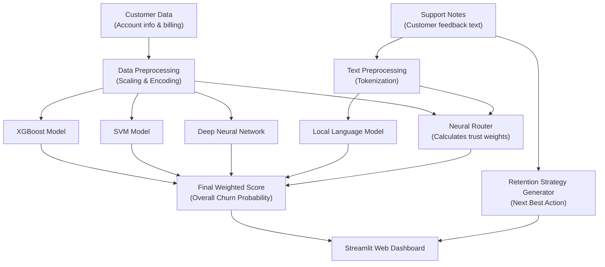

# Proactive Retention Engine 2.0 (PRE 2.0)
### Real-Time Customer Churn Prediction and Retention Dashboard

Proactive Retention Engine 2.0 is a machine learning system designed to help businesses detect customer churn before it happens. Instead of relying only on numbers or only on text, it combines structured customer data (such as billing and contract terms) with customer support notes to predict churn risk and generate actionable retention strategies.

---

## Table of Contents
- [Overview](#overview)
- [How It Works](#how-it-works)
- [The Four Prediction Models](#the-four-prediction-models)
- [Dashboard Features](#dashboard-features)
- [Project Files](#project-files)
- [Getting Started](#getting-started)
- [How to Run](#how-to-run)
- [Frequently Asked Questions](#frequently-asked-questions)
- [License](#license)

---

## Overview

Most traditional churn prediction systems look only at numbers like monthly bills, contract length, and tenure. However, customer frustration often shows up first in support tickets and conversation notes.

PRE 2.0 solves this by using a **Mixture of Experts (MoE)** approach:
- **Numerical and account data** are analyzed by three specialized machine learning models (XGBoost, SVM, and a Deep Neural Network).
- **Customer support text** is analyzed by a local natural language processing model (Phi-3 Mini).
- **A Neural Router** dynamically decides how much weight to give each model for every single customer.
- **An Action Generator** suggests practical retention offers (such as loyalty discounts, technical callbacks, or contract upgrades) tailored to the customer's problem.

---

## How It Works



### The Workflow in Four Simple Steps:
1. **Input**: You enter the customer's account details (tenure, contract type, payment method) and their recent support notes.
2. **Processing**: The data is cleaned, scaled, and converted into formats the models understand.
3. **Evaluation**: Each model makes an independent prediction. The Neural Router evaluates the customer's situation and assigns a weight to each model. For example, if detailed complaint notes are provided, the language model is given higher weight.
4. **Output**: The dashboard displays the final churn risk percentage, visualizes which model contributed most, and recommends an immediate retention step.

---

## The Four Prediction Models

| Model | Type | Analyzes | Purpose |
| :--- | :--- | :--- | :--- |
| **XGBoost** | Gradient Boosting | Account details | Quickly identifies key patterns like high monthly charges and short tenure. |
| **SVM (Support Vector Machine)** | Kernel-based Classifier | Account details | Separates high-risk and low-risk customers using non-linear decision boundaries. |
| **Deep Neural Network (ANN)** | Multi-layer Keras Network | Account details | Captures complex, subtle relationships across all customer attributes. |
| **Local Language Model (Phi-3 Mini)** | 4-bit Quantized NLP / Fallback | Support notes | Reads text feedback to understand frustration, complaints, and threats to cancel. |
| **Neural Router** | Gating Network | Account + Text | Assigns a personalized percentage weight to each model for the customer. |

---

## Dashboard Features

The web interface is built with Streamlit and features a modern dark theme with live indicators:

- **Customer Profile Sidebar**: Easy-to-use inputs for customer demographics, contract type, services, and support history.
- **Ensemble Churn Probability**: Displays a clear percentage score with color indicators:
  - **Green (Low Risk)**: Churn probability under 50%.
  - **Red (High Risk)**: Churn probability 50% or above.
- **Model Weight Breakdown**: An interactive donut chart showing exactly how much each of the four models influenced the final decision.
- **Individual Model Predictions**: Visual progress bars showing the independent churn score of each model alongside its assigned weight.
- **Next Best Action Card**: A clear, plain-language recommendation for customer support agents (for example: *"Offer a 15% loyalty rebate on the next 3 billing cycles"*).
- **System Telemetry**: Displays real-time CPU usage, available cores, RAM consumption, and storage space.

---

## Project Files

| File | Description |
| :--- | :--- |
| **`app.py`** | The main Streamlit dashboard application with interactive charts and live system monitoring. |
| **`inference.py`** | Core inference engine that loads models, applies router weights, and calculates final churn scores. |
| **`model_training.py`** | Script used to train the XGBoost, SVM, Deep ANN, and Neural Router models with SMOTE class balancing. |
| **`preprocessing.py`** | Shared data transformation logic, feature scaling, one-hot encoding, and text tokenization. |
| **`pbl2_prep.py`** | Verification script that tests the data cleaning and feature engineering steps. |
| **`requirements.txt`** | List of all required Python libraries. |
| **`.gitignore`** | Ensures large model files (>100MB) and temporary cache directories are not committed to Git. |
| **`LICENSE`** | MIT open-source license. |

---

## Getting Started

### Prerequisites
- Python 3.10, 3.11, or 3.12 installed on your computer
- Git

### 1. Clone the Repository
```bash
git clone <YOUR_GITHUB_REPOSITORY_URL>
cd pbl-2
```

### 2. Set Up a Virtual Environment

**Using Conda:**
```bash
conda create -n retention-engine python=3.10 -y
conda activate retention-engine
```

**Or using standard Python venv:**
```bash
python -m venv venv

# On Windows:
venv\Scripts\activate

# On macOS / Linux:
source venv/bin/activate
```

### 3. Install Requirements
```bash
pip install -r requirements.txt
```

---

## How to Run

### 1. Run a Quick System Test
To verify that all models load and make predictions correctly, run:
```bash
python inference.py
```
This tests both a high-risk churner scenario and a low-risk retained customer scenario directly in your terminal.

### 2. Start the Web Dashboard
```bash
streamlit run app.py
```
Once launched, open your web browser and go to:
```
http://localhost:8501
```

### 3. (Optional) Retrain the Models
If you want to train all models from scratch:
```bash
python model_training.py
```

---

## Frequently Asked Questions

**Do I need an expensive graphics card (GPU)?**  
No. All models (XGBoost, SVM, Deep Neural Network, and the Neural Router) run smoothly on standard computer processors (CPUs).

**Can this run offline?**  
Yes. All trained model files are stored locally in the folder, so inference runs entirely on your local machine without sending data to outside services.

**Why is the large GGUF model not included in Git?**  
GitHub does not accept files larger than 100 MB, and the 4-bit Phi-3 Mini language model is about 2.4 GB. The dashboard includes a built-in download button to fetch it when needed, and has an automatic built-in sentiment engine so the app works immediately even without downloading the large file.

---

## License

This project is licensed under the [MIT License](LICENSE).
