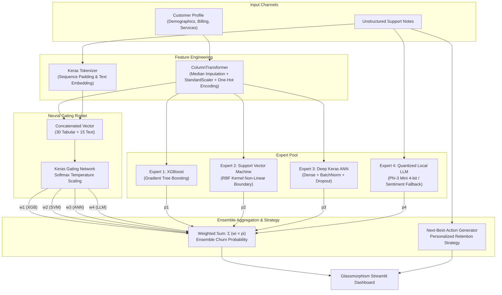

# 🧠 Proactive Retention Engine 2.0 (PRE 2.0)

[](https://www.python.org/)
[](https://streamlit.io/)
[](https://tensorflow.org/)
[](https://scikit-learn.org/)
[](https://xgboost.readthedocs.io/)
[](https://huggingface.co/bartowski/Phi-3-mini-4k-instruct-GGUF)
[](LICENSE)

An enterprise-grade, resource-aware **Soft Mixture of Experts (MoE)** churn intelligence system and edge deployment dashboard. **PRE 2.0** fuses structured customer metrics (demographics, contracts, billing) with unstructured customer support notes to predict churn risk in real-time and synthesize actionable, personalized **"Next Best Action"** retention strategies.

---

## 📌 Table of Contents

- [Overview & Key Innovations](#-overview--key-innovations)
- [System Architecture](#-system-architecture)
- [The 4-Expert MoE Pool](#-the-4-expert-moe-pool)
- [Enterprise Dashboard Features](#-enterprise-dashboard-features)
- [Project Directory Structure](#-project-directory-structure)
- [Installation & Quickstart](#-installation--quickstart)
- [Inference & Model Training Pipeline](#-inference--model-training-pipeline)
- [Large Language Model (LLM) Integration](#-large-language-model-llm-integration)
- [Edge Telemetry & Hardware Efficiency](#-edge-telemetry--hardware-efficiency)
- [License](#-license)

---

## 🌟 Overview & Key Innovations

Traditional churn models evaluate tabular data in isolation, ignoring qualitative sentiment found in unstructured customer service logs. Conversely, pure LLM approaches are too resource-heavy and slow for high-frequency edge classification.

**Proactive Retention Engine 2.0** solves this paradigm through a **Soft Mixture of Experts (MoE)**:
1. **Multimodal Data Fusion**: Combines 19 tabular features (engineered into 30 numerical/categorical features) with NLP-tokenized support interaction transcripts.
2. **Dynamic Neural Gating Router**: A lightweight Keras neural network computes sample-adaptive softmax weights that determine how much each expert is trusted for an individual customer.
3. **Soft Temperature Scaling & NLP Boost**: Prevents router saturation and dynamically boosts textual insight when deep customer complaints are provided.
4. **Generative Retention Strategies**: Synthesizes custom mitigation plans (discounts, priority engineering callbacks, contract restructuring) tailored to the specific churn drivers.

---

## 🏗️ System Architecture



---

## 🤖 The 4-Expert MoE Pool

| Expert | Model Architecture | Input Modality | Primary Strength |
| :--- | :--- | :--- | :--- |
| **Expert 1: XGBoost** | Gradient Boosted Decision Trees (`n_estimators=100`, `max_depth=5`) | 19 Tabular Features (30 Encoded) | Highly effective at capturing non-linear feature splits and tabular interactions |
| **Expert 2: SVM** | Support Vector Classifier (RBF Kernel, probability estimates) | 19 Tabular Features (30 Encoded) | Robust maximum-margin classification in high-dimensional feature spaces |
| **Expert 3: Deep ANN** | Multi-Layer Perceptron (Dense 128 → BatchNorm → Dropout → Dense 64 → Dense 32) | 19 Tabular Features (30 Encoded) | Captures deep representation patterns across customer attributes |
| **Expert 4: Local LLM** | Phi-3 Mini 4K Instruct (4-bit Quantized GGUF / Sentiment Rule Fallback) | Free-Form Customer Support Text | Semantic extraction of frustration, cancellation threats, and service degradation |
| **Neural Router** | Dense Neural Network (Input 45 → Dense 64 → Dropout → Dense 32 → Softmax 4) | Tabular + Text Sequence | Computes dynamic expert credibility distribution per customer |

---

## 💻 Enterprise Dashboard Features

- **Glassmorphism UI**: High-contrast, dark-mode design (`#0a0a1a`) featuring animated glowing cards, frosted glass backdrops, and responsive CSS layouts.
- **Interactive Customer Profiler**: Collapsible sidebar categories for Demographics, Account & Billing, Subscribed Services, and Interaction History.
- **Algorithmic Mix Visualization**: Interactive Plotly donut chart displaying the exact percentage contribution of each model toward the decision.
- **Individual Expert Breakdown**: Color-coded progress bars detailing the standalone churn probability of each expert model alongside its assigned router weight.
- **Real-Time Edge Hardware Monitor**: Live hardware instrumentation using `psutil` measuring physical and logical CPU cores, real-time CPU load, memory utilization, and storage capacity.
- **One-Click GGUF LLM Manager**: In-dashboard Hugging Face downloader for quantized local LLM weights with automatic fallback handling.

---

## 📁 Project Directory Structure

```plaintext
pbl-2/
│
├── .streamlit/
│   └── config.toml               # Streamlit theme and dark-mode configuration
│
├── app.py                        # Streamlit dashboard with glassmorphism UI & live telemetry
├── inference.py                  # End-to-end MoE inference engine & aggregation logic
├── model_training.py             # Training orchestration for 4 Experts + Neural Router
├── preprocessing.py              # Full ETL pipeline, SMOTE, ColumnTransformer & NLP tokenizer
├── pbl2_prep.py                  # Phased preprocessing verification script
│
├── requirements.txt              # Standard Python dependencies
├── requirement.txt               # Legacy requirements file
├── .gitignore                    # Git ignore file (excludes ~2.4GB GGUF model and caches)
├── README.md                     # Comprehensive project documentation
│
├── expert_xgb.pkl                # Trained XGBoost model artifact (~210 KB)
├── expert_svm.pkl                # Trained SVM model artifact (~1.0 MB)
├── expert_ann.h5                 # Trained Deep Keras ANN model artifact (~242 KB)
├── router_model.h5               # Trained Neural Router gating network (~111 KB)
├── tabular_pipeline.pkl          # Fitted ColumnTransformer (scaling + one-hot encoding)
├── tokenizer.pkl                 # Fitted Keras text tokenizer
├── feature_names.pkl             # Serialized engineered feature names list
└── scaler.pkl                    # Serialized numeric scaler checkpoint
```

---

## 🚀 Installation & Quickstart

### Prerequisites
- Python `3.10` or higher (tested with Python 3.10, 3.11, and 3.12)
- Git

### 1. Clone the Repository
```bash
git clone <YOUR_GITHUB_REPOSITORY_URL>
cd pbl-2
```

### 2. Create and Activate a Virtual Environment
```bash
# Using Conda
conda create -n pre-engine python=3.10 -y
conda activate pre-engine

# OR using Python venv
python -m venv venv
# Windows:
venv\Scripts\activate
# Linux/macOS:
source venv/bin/activate
```

### 3. Install Required Dependencies
```bash
pip install -r requirements.txt
```

### 4. Verify the Pipeline (Quick Sanity Check)
```bash
python inference.py
```
*Outputs sample predictions for both high-risk and low-risk test customers along with router distributions.*

### 5. Launch the Dashboard
```bash
streamlit run app.py
```
Open your browser at `http://localhost:8501`.

---

## 🔄 Inference & Model Training Pipeline

### Data Preprocessing
The dataset is sourced from the standard **Telco Customer Churn** benchmark. The script cleans missing values, maps categorical features, and generates representative customer interaction logs:
```bash
python pbl2_prep.py
```

### Retraining All Models
If you wish to retrain the XGBoost, SVM, Deep ANN, and Neural Router from scratch:
```bash
python model_training.py
```
*The script balances tabular training sets using **SMOTE** (Synthetic Minority Over-sampling Technique) to address class imbalance prior to fitting.*

---

## 🤖 Large Language Model (LLM) Integration

The project integrates **Phi-3 Mini 4K Instruct** quantized in 4-bit GGUF format (`Phi-3-mini-4k-instruct-Q4_K_M.gguf`, ~2.4 GB).

### Execution Modes:
1. **Local Quantized LLM Mode**: If the GGUF file is downloaded and either `ctransformers` or `llama-cpp-python` is installed, the engine performs native local token generation on CPU/GPU.
2. **Rule-Based Mock Fallback**: If the GGUF file or runtime is absent, PRE 2.0 seamlessly switches to an internal, zero-latency sentiment analysis and action heuristic.
3. **One-Click Download**: The Streamlit sidebar features a built-in download button that fetches the quantized weights directly from Hugging Face (`bartowski/Phi-3-mini-4k-instruct-GGUF`).

> [!NOTE]
> In compliance with GitHub's 100 MB file size limit, `.gguf` weights are excluded from Git version control via `.gitignore`. The dashboard and inference pipeline run immediately out-of-the-box using the built-in fallback engine, or will download the GGUF model upon request.

---

## ⚡ Edge Telemetry & Hardware Efficiency

PRE 2.0 is designed for constrained edge environments (retail branches, local servers, on-premise workstations):
- **4-bit Quantization**: Reduces LLM memory footprint from ~8 GB to ~2.4 GB RAM.
- **Asynchronous Telemetry**: Uses non-blocking OS queries (`psutil`) to display live system metrics without slowing inference loops.
- **Compact Model Footprint**: Tabular and neural network artifacts require less than 2 MB total disk footprint.

---

## 📜 License

This project is licensed under the [MIT License](LICENSE).
