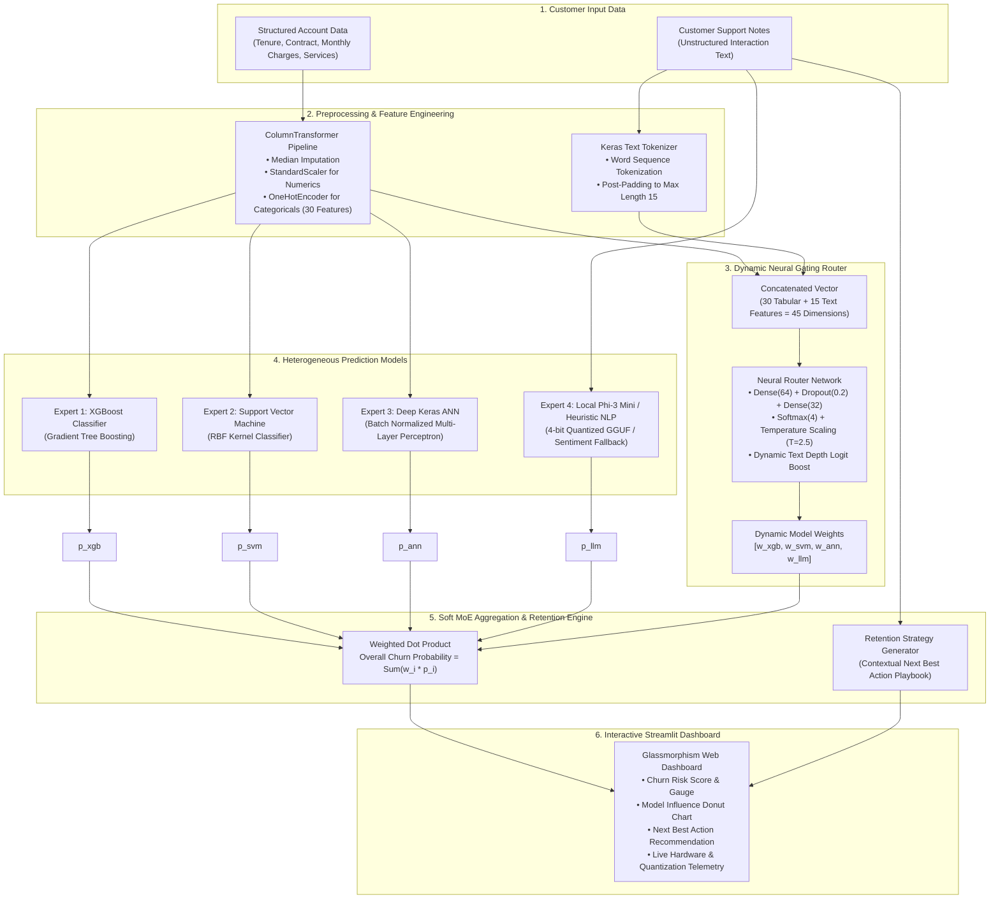

# Proactive Retention Engine 2.0 (PRE 2.0)

[](https://www.python.org/)
[](https://streamlit.io/)
[](https://tensorflow.org/)
[](https://scikit-learn.org/)
[](https://xgboost.readthedocs.io/)
[](LICENSE)

An enterprise-grade, edge-deployable **Mixture of Experts (MoE)** churn intelligence system and interactive dashboard. PRE 2.0 combines structured customer account information with unstructured customer support notes to detect churn risk in real time and generate targeted, actionable retention strategies.

---

## Table of Contents

- [Project Overview](#project-overview)
- [Key Features](#key-features)
- [How the System Works](#how-the-system-works)
- [System Architecture](#system-architecture)
- [The Prediction Models](#the-prediction-models)
- [Neural Router and Mixture of Experts](#neural-router-and-mixture-of-experts)
- [Retention Strategy Generation](#retention-strategy-generation)
- [Dashboard Features](#dashboard-features)
- [Technology Stack](#technology-stack)
- [Project Structure](#project-structure)
- [Installation and Setup](#installation-and-setup)
- [Running the Application](#running-the-application)
- [Model Training](#model-training)
- [Model Files and Large Language Model Setup](#model-files-and-large-language-model-setup)
- [Frequently Asked Questions](#frequently-asked-questions)
- [Limitations and Future Improvements](#limitations-and-future-improvements)
- [License](#license)

---

## Project Overview

Customer churn is a critical problem across subscription and telecommunications industries. Traditional churn prediction systems primarily analyze structured records such as tenure, monthly charges, contract terms, and payment methods. While these indicators highlight historical patterns, they fail to capture immediate customer dissatisfaction that surfaces in customer support interactions, billing disputes, and service outage complaints.

Conversely, relying solely on large language models (LLMs) to process raw transcripts is computationally expensive, introduces latency, and ignores the quantitative signals provided by tabular metrics.

**Proactive Retention Engine 2.0 (PRE 2.0)** addresses both limitations through a **Multimodal Soft Mixture of Experts (MoE)** architecture:
- Structured account records are evaluated across multiple diverse algorithms: **XGBoost**, **Support Vector Machines (SVM)**, and a **Deep Artificial Neural Network (ANN)**.
- Unstructured customer support notes are processed through a local natural language processing engine powered by **Microsoft Phi-3 Mini 4K Instruct** (quantized to 4-bit GGUF) with an internal zero-latency heuristic fallback.
- A **Neural Gating Router** dynamically computes confidence weights for each model based on the customer's unique profile and the presence of complaint notes.
- A **Retention Strategy Generator** translates the prediction into an immediate, contextual "Next Best Action" retention offer for frontline support teams.

---

## Key Features

- **Multimodal Data Fusion**: Combines 19 structured customer account attributes (expanded to 30 encoded features) with free-form interaction text.
- **Heterogeneous Expert Pool**: Harnesses the distinct strengths of gradient tree boosting, margin-based classification, deep representation learning, and language sentiment analysis.
- **Dynamic Gating Network**: Employs a neural router with softmax temperature scaling to allocate individualized trust weights to each model.
- **Context-Aware LLM Scaling**: Dynamically increases language model influence when detailed customer support complaints are detected.
- **Automated Next Best Action**: Synthesizes specific, practical retention strategies (such as loyalty rebates, network technician callbacks, or plan adjustments) based on identified dissatisfaction drivers.
- **Glassmorphism Web Dashboard**: An enterprise dark-mode UI built with Streamlit and Plotly, featuring interactive donut charts and per-model score breakdowns.
- **Real-Time Hardware Telemetry**: Live edge-system monitoring measuring physical and logical CPU cores, real-time CPU utilization, memory consumption, and disk storage via `psutil`.
- **Edge and Offline Capable**: Runs completely locally on standard CPU hardware without external cloud API dependencies.

---

## How the System Works

The end-to-end evaluation follows a structured four-stage workflow:

1. **Input Ingestion**: The user specifies customer details (demographics, contracted services, billing metrics) and inputs recent interaction or support notes into the dashboard sidebar.
2. **Dual-Stream Feature Engineering**:
   - Tabular features are transformed via a scikit-learn `ColumnTransformer` (median imputation and `StandardScaler` for numeric values; one-hot encoding for categorical values), producing a 30-dimensional dense vector.
   - Text notes are tokenized using a Keras `Tokenizer` and padded to a uniform sequence length of 15 tokens.
3. **Neural Routing and Multi-Model Scoring**:
   - Tabular features are passed concurrently to the XGBoost, SVM, and Deep ANN models.
   - Support notes are evaluated by the language model engine.
   - A 45-dimensional concatenated vector (30 tabular + 15 text tokens) is passed into the Neural Router to produce four normalized softmax weights ($w_1, w_2, w_3, w_4$).
4. **Weighted Aggregation and Strategy Synthesis**:
   - The final churn probability is calculated as the dot product of model weights and predictions: $P(\text{churn}) = \sum (w_i \times p_i)$.
   - The retention engine evaluates customer notes and churn risk to prescribe an actionable mitigation step.

---

## System Architecture



---

## The Prediction Models

| Model | Model Type | Input | Primary Responsibility |
| :--- | :--- | :--- | :--- |
| **XGBoost** | Gradient Boosted Decision Trees | 30 Encoded Tabular Features | Identifies non-linear split points, feature thresholds, and numeric interactions (e.g., tenure vs. monthly charges). |
| **Support Vector Machine (SVM)** | Kernel-Based Classifier (`RBF` Kernel) | 30 Encoded Tabular Features | Finds an optimal separating hyperplane in high-dimensional feature space; resilient to localized outliers. |
| **Deep Neural Network (ANN)** | Multi-Layer Perceptron (Keras Sequential) | 30 Encoded Tabular Features | Captures complex cross-attribute representations using Batch Normalization and Dropout layers. |
| **Phi-3 Mini 4K Instruct** | 4-bit Quantized Language Model (`GGUF`) | Free-Form Support Notes | Analyzes qualitative sentiment, dissatisfaction indicators, and cancellation threats directly from text. |
| **Neural Router** | Feedforward Gating Network (`Keras`) | 45 Features (30 Tabular + 15 Text) | Dynamically allocates normalized percentage weights ($w_i$) to determine how much each model contributes. |

---

## Neural Router and Mixture of Experts

In standard ensemble methods (such as simple averaging or fixed stacking), model weights remain static for all records. PRE 2.0 uses a **Soft Mixture of Experts (MoE)** architecture where weights are computed dynamically per customer:

### 1. Temperature Scaling
To prevent the neural router from saturating into an all-or-nothing hard switch (which negates the diversity benefit of an ensemble), the router applies temperature scaling ($T = 2.5$) over its logit outputs:

$$\text{Weight}_i = \frac{\exp(z_i / T)}{\sum_{j=1}^{4} \exp(z_j / T)}$$

### 2. Dynamic NLP Boost
The tabular models are trained on structured historical patterns. When customer support notes contain explicit complaints (e.g., "internet keeps dropping", "unresponsive support"), text sentiment becomes the most critical leading indicator. In `inference.py`, the router detects meaningful text input (greater than 5 characters) and dynamically scales the language model logit above the top tabular model:

$$z_{\text{LLM}} = \max(z_{\text{tabular}}) + 1.5 + \left(\frac{\min(\text{length}(\text{notes}), 100)}{40}\right)$$

### 3. Final Probability Calculation
The overall churn score is computed as a weighted dot product:

$$\text{Churn Probability} = w_{\text{xgb}} \cdot p_{\text{xgb}} + w_{\text{svm}} \cdot p_{\text{svm}} + w_{\text{ann}} \cdot p_{\text{ann}} + w_{\text{llm}} \cdot p_{\text{llm}}$$

A threshold of $0.50$ ($50\%$) categorizes the customer as **High Risk** or **Low Risk**.

---

## Retention Strategy Generation

When churn risk is detected, support personnel require concrete remediation actions rather than an abstract risk score. PRE 2.0 includes an automated **Next Best Action** generator:

1. **LLM Generation**: If the quantized Phi-3 Mini model is loaded, the model evaluates the support transcript with an instruction prompt to produce a concise retention offer.
2. **Heuristic Keyword Engine (Fallback)**: If running in lightweight fallback mode, the engine scans the customer note for specific failure modes:
   - **Billing & Price Concerns**: Recommends a 15% loyalty rebate across the next three billing cycles.
   - **Speed & Connectivity Issues**: Recommends an immediate line diagnostic check and a complimentary speed tier upgrade.
   - **Customer Support Delays**: Recommends assigning a dedicated account manager with guaranteed 24-hour follow-up.
   - **Direct Cancellation Threats**: Prescribes an urgent win-back outreach bundle with an annual discount.
   - **Standard Check-in**: Recommends a proactive satisfaction check-in call with service review.

---

## Dashboard Features

The web dashboard is developed in **Streamlit** and configured with custom dark-mode Glassmorphism styling (`.streamlit/config.toml`):

- **Customer Profile Builder**: Grouped sidebar expanders covering Demographics, Account & Billing, Subscribed Services, Monthly/Total Charges, and Customer Support Notes.
- **Real-Time Prediction Trigger**: A single-click button initiates end-to-end preprocessing, multi-model execution, and strategy generation.
- **Ensemble Churn Probability Card**: Displays the aggregate churn score with glowing visual indicators (Emerald Green for Low Risk; Crimson Red for High Risk).
- **Algorithmic Mix Donut Chart**: An interactive Plotly chart breaking down the exact percentage share contributed by XGBoost, SVM, Deep ANN, and the Language Model.
- **Individual Expert Vote Breakdown**: Color-coded progress bars displaying each individual model's predicted probability alongside its allocated router weight.
- **Next Best Action Card**: A highlighted recommendation panel providing targeted advice for retention representatives.
- **Live Hardware Telemetry Bar**: Real-time physical and logical CPU core counts, live CPU load percentage, RAM memory allocation (including 4-bit quantization monitoring), and storage volume metrics via `psutil`.

---

## Technology Stack

The project relies strictly on established open-source machine learning and data science libraries:

- **Python**: Core programming language (tested with Python 3.10, 3.11, and 3.12).
- **Streamlit**: Web dashboard framework, session state handling, and interactive UI components.
- **Plotly**: Interactive data visualizations and donut charts.
- **TensorFlow / Keras**: Deep Artificial Neural Network (ANN), Neural Gating Router, and Keras text Tokenizer.
- **Scikit-learn**: Support Vector Classification (SVC), `ColumnTransformer`, `StandardScaler`, `OneHotEncoder`, `SimpleImputer`, and evaluation metrics.
- **XGBoost**: Gradient boosted decision tree implementation (`XGBClassifier`).
- **Imbalanced-learn**: Synthetic Minority Over-sampling Technique (SMOTE) for class rebalancing.
- **Pandas & NumPy**: Tabular data manipulation, matrix operations, and feature transformations.
- **Psutil**: Operating system and hardware telemetry tracking.
- **Joblib**: Pipeline, scaler, and model artifact serialization.
- **Hugging Face Hub**: Model repository integration for automated GGUF weight retrieval.
- **GGUF Runtime Support**: Compatible with `ctransformers` and `llama-cpp-python` for 4-bit local LLM execution.

---

## Project Structure

```plaintext
pbl-2/
│
├── .streamlit/
│   └── config.toml               # Streamlit theme and dark-mode configuration
│
├── app.py                        # Main Streamlit web dashboard application
├── inference.py                  # End-to-end MoE inference engine and probability aggregation
├── model_training.py             # Model training script for Experts 1-3, Router, and LLM setup
├── preprocessing.py              # Full ETL pipeline, ColumnTransformer, and NLP tokenizer
├── pbl2_prep.py                  # Phased preprocessing verification and demonstration script
│
├── requirements.txt              # Standard Python package dependencies
├── requirement.txt               # Legacy package requirements file
├── .gitignore                    # Excludes large binaries (*.gguf), caches, and virtual envs
├── LICENSE                       # MIT Open-Source License
├── README.md                     # Comprehensive project documentation
│
├── expert_xgb.pkl                # Trained XGBoost model artifact (~210 KB)
├── expert_svm.pkl                # Trained SVM model artifact (~1.0 MB)
├── expert_ann.h5                 # Trained Deep Keras ANN model artifact (~242 KB)
├── router_model.h5               # Trained Neural Router gating network (~111 KB)
├── tabular_pipeline.pkl          # Fitted ColumnTransformer (scaling + one-hot encoding) (~8 KB)
├── tokenizer.pkl                 # Fitted Keras text tokenizer (~3 KB)
├── feature_names.pkl             # Serialized engineered feature names list (<1 KB)
└── scaler.pkl                    # Serialized numeric scaler checkpoint (<1 KB)
```

---

## Installation and Setup

### Prerequisites
- Python 3.10, 3.11, or 3.12
- Git installed on your system

### 1. Clone the Repository
```bash
git clone <YOUR_GITHUB_REPOSITORY_URL>
cd pbl-2
```

### 2. Create and Activate a Virtual Environment

**On Windows (PowerShell):**
```powershell
python -m venv venv
.\venv\Scripts\Activate.ps1
```

**On Windows (Command Prompt):**
```cmd
python -m venv venv
venv\Scripts\activate.bat
```

**On Linux / macOS:**
```bash
python3 -m venv venv
source venv/bin/activate
```

**Using Conda (Alternative):**
```bash
conda create -n retention-engine python=3.10 -y
conda activate retention-engine
```

### 3. Install Dependencies
```bash
pip install -r requirements.txt
```

---

## Running the Application

### 1. Run the Pipeline Verification Test
Before starting the web server, verify that all serialized model artifacts, pipelines, and inference routines function correctly:
```bash
python inference.py
```

Expected terminal output:
```text
============================================================
  INFERENCE PIPELINE — Quick Test
============================================================
[Inference] Loading artifacts...
[Inference] All artifacts loaded.

  Test 1 — Likely Churner:
    Router Weights: XGB=0.143, SVM=0.153, ANN=0.154, LLM=0.549
    Expert Preds:   XGB=0.824, SVM=0.718, ANN=0.836, LLM=0.900
    Ensemble Score: 0.8514 (High Risk)
    Strategy: Escalate to network engineering for priority line diagnostics and a free speed upgrade.

  Test 2 — Likely Retained:
    Router Weights: XGB=0.165, SVM=0.027, ANN=0.220, LLM=0.587
    Expert Preds:   XGB=0.019, SVM=0.033, ANN=0.029, LLM=0.100
    Ensemble Score: 0.0692 (Low Risk)
    Strategy: Schedule a courtesy check-in call to proactively gather feedback and offer an upgrade.

============================================================
  Inference pipeline working correctly!
============================================================
```

### 2. Launch the Streamlit Dashboard
```bash
streamlit run app.py
```
After startup, open your web browser and navigate to the local URL (default: `http://localhost:8501`).

---

## Model Training

The repository includes pre-trained model checkpoints so the application can run immediately after cloning. If you wish to retrain all models from scratch:

### 1. Run Phased Data Preparation
```bash
python pbl2_prep.py
```
This script downloads the raw Telco dataset, cleans missing values, fits the `ColumnTransformer`, generates synthetic customer support notes, and fits the Keras text tokenizer.

### 2. Retrain the Complete MoE Ensemble
```bash
python model_training.py
```
This script:
1. Executes the preprocessing pipeline.
2. Applies **SMOTE** oversampling to balance the churn class in the training split.
3. Fits and evaluates Expert 1 (XGBoost), Expert 2 (SVM), and Expert 3 (Deep Keras ANN).
4. Generates soft cross-entropy training targets based on model performance.
5. Fits and evaluates the Neural Gating Router.
6. Saves updated model artifacts (`.pkl` and `.h5`) to the repository root.

---

## Model Files and Large Language Model Setup

### Serialized Model Checkpoints
The repository tracks all core tabular and neural model files directly in Git because their collective size is less than 2 MB:
- `expert_xgb.pkl` (~210 KB)
- `expert_svm.pkl` (~1.0 MB)
- `expert_ann.h5` (~242 KB)
- `router_model.h5` (~111 KB)
- `tabular_pipeline.pkl`, `tokenizer.pkl`, `feature_names.pkl`, `scaler.pkl` (<15 KB total)

### Phi-3 Mini 4-bit GGUF Model (~2.4 GB)
Due to GitHub's strict 100 MB per-file upload limit, the quantized language model binary `Phi-3-mini-4k-instruct-Q4_K_M.gguf` is excluded via `.gitignore`.

The application supports three operational modes:
1. **Built-In Sentiment Engine (Default)**: If the `.gguf` file is not present, the system automatically uses its rule-based keyword sentiment and strategy engine. No downloads are required, and the dashboard functions immediately.
2. **In-Dashboard Downloader**: If you wish to use the real local LLM, launch `streamlit run app.py` and click the **"📥 Download Phi-3 GGUF"** button in the sidebar. This downloads the model directly from Hugging Face (`bartowski/Phi-3-mini-4k-instruct-GGUF`).
3. **Manual Download**: You can manually download `Phi-3-mini-4k-instruct-Q4_K_M.gguf` from Hugging Face and place it directly into the repository root.

To enable local LLM execution, install one of the compatible runtime libraries:
```bash
pip install ctransformers
# OR
pip install llama-cpp-python
```

---

## Frequently Asked Questions

**1. Does this project require an NVIDIA GPU?**  
No. All tabular models, the neural gating router, and the 4-bit quantized Phi-3 Mini GGUF model run smoothly on multi-core consumer CPUs without requiring CUDA or dedicated GPUs.

**2. Can the system operate entirely offline?**  
Yes. Once dependencies and model artifacts are in place, the entire inference pipeline executes locally without transmitting customer data to external cloud APIs.

**3. Why is SMOTE applied only to the tabular training set?**  
SMOTE synthetically generates tabular feature vectors to address minority-class imbalance (churned customers). Applying it exclusively to the training set prevents synthetic data leakage into evaluation splits.

**4. How does the Neural Router balance tabular metrics against customer text?**  
The router evaluates a concatenated 45-dimensional vector containing both tabular and text representations. If a customer provides detailed complaint text, the router dynamically increases the language model weight ($w_{\text{llm}}$). If text is absent or minimal, the router distributes influence predominantly across the three tabular experts.

---

## Limitations and Future Improvements

- **Synthetic Text Labels**: In the demonstration dataset, support notes are rule-generated to simulate realistic customer interactions. Integrating production customer service call transcripts or CRM ticketing APIs would improve real-world calibration.
- **Bidirectional Router Feedback**: Currently, router targets are computed from static cross-entropy loss against validation ground truth. Future iterations could train the router and experts jointly using an end-to-end sparse MoE loss function.
- **Batch Processing**: The current Streamlit interface focuses on single-customer real-time analysis. Adding a batch CSV processing interface would allow enterprise teams to score entire customer databases simultaneously.

---

## License

This project is licensed under the [MIT License](LICENSE).
