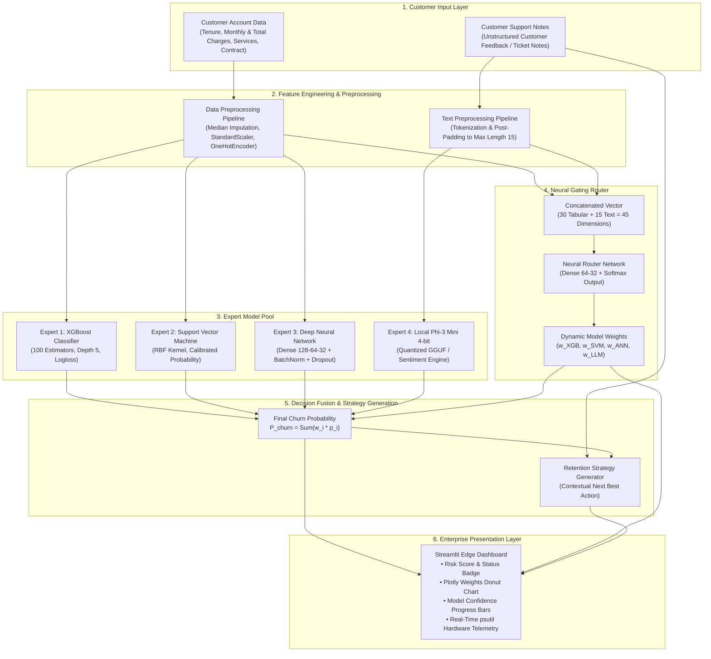

# Proactive Retention Engine 2.0 (PRE 2.0)
### Real-Time Customer Churn Prediction and Retention Dashboard

[](https://www.python.org/)
[](https://streamlit.io/)
[](https://www.tensorflow.org/)
[](https://scikit-learn.org/)
[](https://xgboost.ai/)
[](LICENSE)

---

## Table of Contents
- [Project Overview](#project-overview)
- [Key Features](#key-features)
- [How the System Works](#how-the-system-works)
- [System Architecture](#system-architecture)
- [The Prediction Models](#the-prediction-models)
- [Neural Router and Mixture of Experts](#neural-router-and-mixture-of-experts)
- [Retention Strategy Generation](#retention-strategy-generation)
- [Dashboard Features](#dashboard-features)
- [Technology Stack](#technology-stack)
- [Project Structure](#project-structure)
- [Installation and Setup](#installation-and-setup)
- [Running the Application](#running-the-application)
- [Model Training](#model-training)
- [Model Files and Large Language Model Setup](#model-files-and-large-language-model-setup)
- [Frequently Asked Questions](#frequently-asked-questions)
- [Limitations and Future Improvements](#limitations-and-future-improvements)
- [License](#license)

---

## Project Overview

**Proactive Retention Engine 2.0 (PRE 2.0)** is an enterprise machine learning solution engineered to detect customer churn before cancellation occurs. 

Traditional churn prediction models analyze purely structured tabular metrics—such as contract duration, payment method, monthly charges, and tenure. However, early dissatisfaction and customer attrition intent consistently manifest inside unstructured channels: customer support transcripts, issue tickets, and qualitative representative notes.

PRE 2.0 addresses this blind spot through a multi-modal **Soft Mixture of Experts (MoE)** architecture:
- **Structured account metrics** are evaluated concurrently by three distinct tabular machine learning algorithms (**XGBoost**, **Support Vector Classifier**, and a **Deep Artificial Neural Network**).
- **Unstructured support notes** are evaluated using a quantized local language model (**Microsoft Phi-3 Mini 4K Instruct** in 4-bit GGUF format, supported by an automated sentiment fallback engine).
- A specialized **Neural Gating Router** analyzes both tabular and textual signals to calculate sample-level confidence weights for each expert.
- An **AI Retention Strategy Generator** synthesizes the customer risk level and interaction context into a concrete, 1–2 sentence "Next Best Action" retention plan.
- An **Enterprise Glassmorphism Dashboard** built in Streamlit surfaces real-time predictions, model attribution donut charts, and live hardware resource telemetry.

---

## Key Features

- **Dual-Modal Data Ingestion**: Seamlessly fuses 19 structured customer account attributes (expanded into 30 engineered features) with qualitative natural language support text.
- **Soft Mixture of Experts (MoE)**: Leverages 4 diverse expert models rather than a monolithic classifier, maximizing ensemble variance reduction and predictive fidelity.
- **Adaptive Neural Router**: Dynamically calculates per-customer weighting factors using a temperature-scaled gating network, giving precedence to text or tabular features based on data quality.
- **Generative Retention Strategies**: Translates numerical churn probabilities into immediate operational countermeasures (e.g., promotional credits, priority technical routing, contract restructuring).
- **Privacy-Preserving Edge Inference**: Employs 4-bit quantized GGUF weights, enabling high-performance local inference on commodity CPUs with zero third-party cloud data transmission.
- **Resilient Fallback Hierarchy**: Features a zero-crash architecture that gracefully defaults to an internal heuristic sentiment analyzer if local GGUF runtimes are not configured.
- **Real-Time Hardware Telemetry**: Continuously monitors physical/logical CPU utilization, memory pressure, and storage volume directly within the dashboard.

---

## How the System Works

The prediction and intervention lifecycle executes across five sequential stages:

```
[Customer Telemetry] ──> [Feature Pipelines] ──> [4 Expert Inferences] ──> [Soft Gating] ──> [Ensemble & Action]
```

1. **Input Collection**: Account attributes (tenure, billing method, active services, recurring charges) and recent customer interaction notes are submitted via the interactive sidebar.
2. **Feature Preprocessing**:
   - Tabular features undergo missing value imputation, standard scaling for continuous variables (`tenure`, `MonthlyCharges`, `TotalCharges`), and one-hot encoding for categorical variables.
   - Support notes are tokenized into integer sequence vectors and padded to a fixed sequence length of 15 tokens.
3. **Multi-Expert Evaluation**:
   - Tabular features are simultaneously processed by **XGBoost**, **SVM**, and the **Deep ANN**.
   - Text features are evaluated by **Phi-3 Mini** (or the sentiment fallback engine) to derive an independent sentiment churn risk score.
4. **Dynamic Gating & Score Fusion**:
   - The concatenated feature vector (30 tabular + 15 text tokens = 45 dimensions) enters the Keras-based **Neural Router**.
   - The router applies temperature-scaled softmax weighting across all four models. If rich support complaint text is detected, the router dynamically increases the LLM's contribution.
   - The final churn probability is computed as the weighted dot product of the expert predictions and router weights:
     
     $$\text{Churn Probability} = \sum_{i=1}^{4} w_i \cdot p_i$$

5. **Retention Action & UI Rendering**: Churn probability, individual model breakdowns, dynamic weights, and a tailored "Next Best Action" are visualized immediately on the dashboard.

---

## System Architecture

The following diagram illustrates the complete end-to-end data processing, expert inference, neural routing, and user interface delivery pipeline:



---

## The Prediction Models

PRE 2.0 incorporates five specialized machine learning and deep learning models. The table below details their architectures, inputs, and functional responsibilities:

| Model | Model Type | Input | Primary Responsibility |
| :--- | :--- | :--- | :--- |
| **XGBoost** | Gradient Boosted Decision Trees (`XGBClassifier`) | 30 Tabular Features (Scaled & One-Hot Encoded) | Identifies sharp non-linear thresholds and decision boundaries across billing metrics, contract types, and service subscriptions. |
| **Support Vector Machine (SVM)** | Kernel Classifier (`SVC` with RBF Kernel & Probability Calibration) | 30 Tabular Features (Scaled & One-Hot Encoded) | Maximizes classification margin in high-dimensional continuous space, delivering reliable baseline predictions on boundary cases. |
| **Deep Neural Network (ANN)** | 4-Layer Sequential Keras Network (128 → 64 → 32 → 1) with Batch Normalization & Dropout | 30 Tabular Features (Scaled & One-Hot Encoded) | Captures deep inter-feature dependencies and subtle interaction terms across complex account demographics. |
| **Phi-3 Mini 4K Instruct** | 4-bit Quantized Small Language Model (`Q4_K_M` GGUF) / Heuristic Sentiment Fallback | Unstructured Support Notes (Raw Text) | Interprets customer sentiment, complaint urgency, and explicit cancellation threats from natural language interactions. |
| **Neural Router** | Keras Gating Network (Input 45 → Dense 64 → Dense 32 → Softmax 4) | 45 Concatenated Features (30 Tabular + 15 Text Tokens) | Evaluates sample-level data quality to determine dynamic confidence weights for each expert model. |

---

## Neural Router and Mixture of Experts

### Why Soft Mixture of Experts?
Standard ensemble techniques (such as hard majority voting or static averaging) treat all models equally regardless of input quality. If an account has empty support notes, tabular models should dominate. Conversely, when a customer explicitly states an intention to cancel, the language model should take precedence.

### The Gating Mechanism
1. **Target Formulation**: During training, the router is trained on soft targets derived from inverse absolute prediction errors across all experts:
   
   $$\text{Error}_i = |p_i - y_{\text{true}}|$$
   
   $$\text{Target}_i = \frac{\exp\left(\frac{1}{(\text{Error}_i + \epsilon) \cdot T_{\text{train}}}\right)}{\sum_j \exp\left(\frac{1}{(\text{Error}_j + \epsilon) \cdot T_{\text{train}}}\right)}$$

2. **Temperature Scaling**: Standard softmax networks often collapse into hard one-hot distributions ($1.0$ vs $0.0$). In `inference.py`, PRE 2.0 applies temperature scaling ($T = 2.5$) over the router logits to maintain smooth, balanced contributions across models.
3. **Dynamic Text Logit Boosting**: When meaningful textual feedback ($>5$ characters) is present, the router programmatically boosts the LLM logit relative to the top tabular model based on text length, ensuring customer complaints receive immediate operational focus.

---

## Retention Strategy Generation

Beyond calculating churn probability, PRE 2.0 generates actionable business interventions tailored to the underlying problem.

### 1. Large Language Model Mode (Phi-3 Mini)
When the local GGUF model is loaded via `ctransformers` or `llama-cpp-python`, the engine constructs a focused prompt:

```text
You are a customer retention strategist. Based on this customer's support note, 
suggest ONE short, actionable 'Next Best Action' to prevent churn. Keep it to 1-2 sentences.

Note: "{Customer Support Note}"
Retention strategy:
```

Outputs are automatically sanitized using regex filters to strip assistant tags (`<|assistant|>`), markdown headers, and conversational prefixes, ensuring flawless visual presentation.

### 2. Built-In Heuristic Fallback Engine
When operating in lightweight mode without local LLM runtimes, the system activates a rule-based engine mapping interaction keywords to proven retention actions:

| Trigger Keywords | Operational Root Cause | Recommended Next Best Action |
| :--- | :--- | :--- |
| `price`, `fee`, `overcharge`, `bill`, `charge` | Billing & Pricing Friction | Offer a 15% loyalty discount across the next 3 billing cycles. |
| `speed`, `slow`, `drop`, `outage`, `connection` | Technical Infrastructure Outage | Escalate to network engineering for priority diagnostics and a complimentary speed upgrade. |
| `support`, `waiting`, `technician`, `help` | Service & Support Latency | Assign a dedicated account manager for proactive follow-ups within 24 hours. |
| `cancel`, `quit`, `switch`, `leave` | Imminent Churn Threat | Initiate an urgent win-back call with an exclusive 12-month retention bundle at 20% off. |
| `bad`, `worst`, `terrible`, `awful`, `horrible` | General Dissatisfaction | Provide a discretionary service credit and schedule a priority callback from senior support. |

---

## Dashboard Features

The dashboard is built with a custom-engineered **Glassmorphism Dark Theme** designed for enterprise operations:

```
┌────────────────────────────────────────────────────────────────────────┐
│               PROACTIVE RETENTION ENGINE 2.0 — DASHBOARD               │
│               Real-Time Customer Churn Prediction & Edge MoE           │
├────────────────────┬───────────────────────────────────────────────────┤
│  CUSTOMER PROFILE  │  [ENSEMBLE RISK]    [CPU UTILIZATION]  [RAM USAGE]│
│  • Demographics    │       84.2%               24.6%          3.8 GB   │
│  • Account Terms   │     🔴 HIGH RISK        4C / 8T Cores   38% Used  │
│  • Active Services ├─────────────────────────┬─────────────────────────┤
│  • Billing Metrics │   ALGORITHMIC MIX       │  AI RETENTION STRATEGY  │
│  • Support Notes   │   (Plotly Donut Chart)  │  [Next Best Action Card]│
│                    │   • XGBoost:   22.4%    │  Offer a 15% loyalty    │
│  [⚡ Run Analysis]  │   • SVM:       18.1%    │  rebate on the next 3   │
│                    │   • Deep ANN:  25.3%    │  billing cycles.        │
│  [📥 Download LLM] │   • Local LLM: 34.2%    │                         │
│                    ├─────────────────────────┴─────────────────────────┤
│                    │  INDIVIDUAL EXPERT CONFIDENCE BARS                │
│                    │  🌲 XGBoost    [████████░░░░] 74.0%  (w=0.224)    │
│                    │  📐 SVM        [███████░░░░░] 68.5%  (w=0.181)    │
│                    │  🧠 Deep ANN   [█████████░░░] 81.2%  (w=0.253)    │
│                    │  💬 Local LLM  [███████████░] 92.0%  (w=0.342)    │
│                    ├───────────────────────────────────────────────────┤
│                    │  HARDWARE TELEMETRY (Physical/Logical Cores, RAM) │
└────────────────────┴───────────────────────────────────────────────────┘
```

- **Interactive Configuration Sidebar**: Real-time controls for customer tenure (0–72 months), contract terms, payment methods, telephone/internet services, monthly billing, and qualitative support notes.
- **Ensemble Churn Probability Card**: High-contrast indicator displaying final fused risk percentage and status badge (**Low Risk < 50%** in emerald green, **High Risk ≥ 50%** in crimson red).
- **Algorithmic Mix Donut Chart**: Plotly interactive visualization depicting exact percentage shares allocated by the Neural Router.
- **Model Confidence Breakdown**: Linear visual meters tracking each expert's isolated churn assessment against its assigned weighting factor.
- **Next Best Action Card**: Highlighted callout delivering clear guidance to customer support representatives.
- **Hardware Telemetry Grid**: Direct integration with `psutil` reporting real-time CPU load, core topology, RAM consumption, and disk storage usage.
- **One-Click GGUF Downloader**: Sidebar action button to download the 4-bit Phi-3 Mini GGUF model (~2.4 GB) directly from Hugging Face Hub.

---

## Technology Stack

The project relies on a production-grade Python ecosystem for scientific computing, deep learning, natural language processing, and interactive visualization:

| Category | Technology | Version | Purpose |
| :--- | :--- | :--- | :--- |
| **Language** | [Python](https://www.python.org/) | `>=3.10, <3.13` | Core programming runtime |
| **Web Dashboard** | [Streamlit](https://streamlit.io/) | `>=1.28.0` | Reactive user interface and session management |
| **Data Visualization** | [Plotly](https://plotly.com/) | `>=5.18.0` | High-fidelity interactive donut and distribution charts |
| **System Telemetry** | [psutil](https://github.com/giampaolo/psutil) | `>=5.9.0` | Real-time monitoring of CPU cores, RAM, and disk utilization |
| **Data Manipulation** | [Pandas](https://pandas.pydata.org/) | `>=2.0.0` | Tabular data structures, transformations, and cleaning |
| **Numerical Computing** | [NumPy](https://numpy.org/) | `>=1.24.0` | Matrix mathematics and array vectorization |
| **Scientific Routines** | [SciPy](https://scipy.org/) | `>=1.11.0` | Softmax scaling and temperature calculations |
| **Machine Learning** | [Scikit-Learn](https://scikit-learn.org/) | `>=1.3.0` | Pipeline management, StandardScaler, OneHotEncoder, SVM |
| **Gradient Boosting** | [XGBoost](https://xgboost.ai/) | `>=2.0.0` | Regularized tree boosting classifier (`XGBClassifier`) |
| **Class Balancing** | [Imbalanced-Learn](https://imbalanced-learn.org/) | `>=0.11.0` | Synthetic Minority Over-sampling Technique (SMOTE) |
| **Model Serialization** | [Joblib](https://joblib.readthedocs.io/) | `>=1.3.0` | Persistence for scikit-learn pipelines and model weights |
| **Deep Learning** | [TensorFlow / Keras](https://www.tensorflow.org/) | `>=2.13.0` | Multi-layer Perceptron (ANN) and Neural Gating Router |
| **Model Distribution** | [Hugging Face Hub](https://huggingface.co/) | `>=0.20.0` | Automated download management for quantized GGUF artifacts |
| **Quantized LLM Engine** | [ctransformers](https://github.com/marella/ctransformers) / [llama-cpp-python](https://github.com/abetlen/llama-cpp-python) | *Optional* | Local C++ GGUF inference runtimes for Phi-3 Mini |

---

## Project Structure

Below is the verified layout of the repository root and its key operational components:

```
pbl 2/
├── .streamlit/
│   └── config.toml                  # Streamlit dark theme & headless server configuration
├── app.py                           # Streamlit enterprise dashboard & hardware monitoring
├── inference.py                     # Hybrid MoE inference pipeline & ensemble logic
├── model_training.py                # Multi-expert & Neural Router training script
├── preprocessing.py                 # Shared data pipelines, tokenization, & synthetic text
├── pbl2_prep.py                     # 4-phase data preparation & verification script
├── requirements.txt                 # Core project dependencies specification
├── requirement.txt                  # Compatibility alias for requirements.txt
├── LICENSE                          # MIT Open Source License file
├── .gitignore                       # Rules excluding GGUF models, caches, and environments
│
├── [Trained Model Artifacts]
│   ├── expert_xgb.pkl               # Serialized trained XGBoost classifier (Joblib)
│   ├── expert_svm.pkl               # Serialized trained Support Vector Classifier (Joblib)
│   ├── expert_ann.h5                # Trained Keras Deep Neural Network weights (HDF5)
│   ├── router_model.h5              # Trained Keras Neural Gating Router weights (HDF5)
│   ├── tabular_pipeline.pkl         # Fitted ColumnTransformer (Imputer + Scaler + Encoder)
│   ├── tokenizer.pkl                # Fitted Keras text Tokenizer for support notes
│   ├── feature_names.pkl            # Ordered list of 30 engineered tabular features
│   └── scaler.pkl                   # Legacy standalone StandardScaler artifact
│
└── [Quantized Language Model]
    └── Phi-3-mini-4k-instruct-Q4_K_M.gguf  # 4-bit quantized Phi-3 model (~2.4 GB, local)
```

### Key Module Descriptions
- **`app.py`**: Entry-point for the web dashboard. Implements custom CSS glassmorphism, responsive column layouts, Plotly charting, and background hardware sampling.
- **`inference.py`**: Production inference module. Implements `prepare_inputs()`, `get_router_weights()`, `get_expert_predictions()`, and `ensemble_predict()`.
- **`model_training.py`**: End-to-end training orchestrator. Fetches data, applies SMOTE class balancing, fits all models, creates soft router targets, and serializes artifacts.
- **`preprocessing.py`**: Defines standard schemas (`NUMERIC_FEATURES`, `CATEGORICAL_FEATURES`), data cleaning routines, and text sequence padding.
- **`pbl2_prep.py`**: A clean verification utility that executes data cleaning, scaling, synthetic note generation, and tokenization with structured terminal checkpoints.

---

## Installation and Setup

### Prerequisites
- **Python**: Version `3.10`, `3.11`, or `3.12` installed.
- **Git**: Installed and available in your system path.
- **Memory**: Minimum 4 GB RAM (8 GB+ recommended if running the GGUF LLM).

### 1. Clone the Repository
```bash
git clone <YOUR_REPOSITORY_URL>
cd "pbl 2"
```

### 2. Create and Activate a Virtual Environment

**Option A: Using standard Python `venv`**

- **Windows (PowerShell)**:
  ```powershell
  python -m venv venv
  .\venv\Scripts\Activate.ps1
  ```
- **Windows (Command Prompt)**:
  ```cmd
  python -m venv venv
  .\venv\Scripts\activate.bat
  ```
- **macOS / Linux**:
  ```bash
  python3 -m venv venv
  source venv/bin/activate
  ```

**Option B: Using Conda**
```bash
conda create -n pre-engine python=3.10 -y
conda activate pre-engine
```

### 3. Install Dependencies
Install all required libraries using `pip`:
```bash
pip install -r requirements.txt
```

*(Optional)* If you wish to execute the local Phi-3 Mini model using hardware-accelerated C++ runtimes rather than the built-in sentiment engine:
```bash
pip install ctransformers>=0.2.27
# OR
pip install llama-cpp-python>=0.2.55
```

---

## Running the Application

### 1. Execute the Inference Self-Test
Verify that all model weights, pipelines, and routing mathematics execute cleanly:
```bash
python inference.py
```
This runs automated predictions across two distinct customer scenarios (an at-risk month-to-month subscriber and a loyal long-term subscriber) and outputs router weights to the terminal.

### 2. Launch the Streamlit Dashboard
Start the web dashboard locally:
```bash
streamlit run app.py
```
Once the server initializes, open your browser and navigate to:
```text
http://localhost:8501
```

### 3. Verify Preprocessing Pipeline
To inspect the 4-phase feature transformations without retraining:
```bash
python pbl2_prep.py
```

---

## Model Training

All model artifacts are pre-trained and included in the repository. If you wish to retrain all experts and the Neural Router from scratch:

```bash
python model_training.py
```

### What Happens During Training:
1. **Dataset Ingestion**: Automatically downloads the standard Telco Customer Churn dataset (7,043 customer records).
2. **Data Cleaning**: Coerces `TotalCharges` to numeric and imputes missing values using the median.
3. **Synthetic Note Synthesis**: Generates paired customer feedback notes conditioned on churn labels to simulate real-world support ticket archives.
4. **Train/Test Splitting**: Stratified 80/20 train/test split preserving churn class ratios.
5. **Class Imbalance Balancing**: Applies **SMOTE** (Synthetic Minority Over-sampling Technique) to tabular training data, balancing churned and retained classes.
6. **Expert Fitting**:
   - Trains **XGBoost** with logloss early evaluation.
   - Trains **Support Vector Classifier (SVM)** with Platt probability calibration.
   - Trains the **Deep Artificial Neural Network (ANN)** for 50 epochs with `EarlyStopping` (patience = 5).
7. **Soft Target Calculation**: Runs all training samples through the fitted experts to generate inverse-error softmax targets.
8. **Neural Router Training**: Fits the 4-output gating network using categorical cross-entropy.
9. **Artifact Serialization**: Saves all `.pkl` and `.h5` files directly into the repository root.

---

## Model Files and Large Language Model Setup

### Serialized Model Artifacts
The repository root contains the exact weights required for offline execution:

| File | Size | Format | Description |
| :--- | :--- | :--- | :--- |
| `expert_xgb.pkl` | ~210 KB | Joblib Pickle | Trained XGBoost gradient boosted tree ensemble |
| `expert_svm.pkl` | ~1.08 MB | Joblib Pickle | Trained Support Vector Classifier support vectors |
| `expert_ann.h5` | ~243 KB | Keras HDF5 | 4-layer Deep Neural Network architecture & weights |
| `router_model.h5` | ~111 KB | Keras HDF5 | Neural Gating Router architecture & weights |
| `tabular_pipeline.pkl` | ~8 KB | Joblib Pickle | Scikit-learn transformer (imputation, scaling, one-hot encoding) |
| `tokenizer.pkl` | ~3 KB | Joblib Pickle | Keras text tokenizer fit on support feedback vocabulary |
| `feature_names.pkl` | ~1 KB | Joblib Pickle | 30 ordered feature column identifiers |

### Large Language Model (Phi-3 Mini 4K Instruct)
- **Model Tag**: `bartowski/Phi-3-mini-4k-instruct-GGUF`
- **Weight Quantization**: `Phi-3-mini-4k-instruct-Q4_K_M.gguf` (~2.39 GB)
- **Local Availability**: The quantized file is stored locally in the project directory for offline edge execution.
- **Git Version Control**: Because GitHub enforces a 100 MB hard limit on individual files, `*.gguf` is recorded in `.gitignore`.
- **Automated In-App Download**: If the GGUF file is ever missing, click the **📥 Download Phi-3 GGUF** button in the dashboard sidebar, or invoke `_download_gguf()` programmatically via `model_training.py`.

---

## Frequently Asked Questions

#### Q: Do I need a dedicated GPU (CUDA) to run PRE 2.0?
**A:** No. All three tabular models (XGBoost, SVM, Deep ANN) and the Neural Router run with sub-10ms latency on modern CPUs. The Phi-3 Mini model is quantized to 4-bit precision (`Q4_K_M`), enabling CPU execution with minimal RAM footprint.

#### Q: Will the application function if I do not install `ctransformers` or `llama-cpp-python`?
**A:** Yes. The application is built with a resilient fallback architecture. If local GGUF runtimes are not found, PRE 2.0 activates its internal keyword-driven sentiment analysis and retention strategy engine without throwing errors.

#### Q: Is any customer data sent to third-party APIs (e.g., OpenAI or Anthropic)?
**A:** None. PRE 2.0 is designed for strictly on-premises and edge deployments. All feature scaling, neural gating, and language model inferences execute locally inside your Python runtime.

#### Q: Can I retrain the engine on custom enterprise datasets?
**A:** Yes. Update the column definitions (`NUMERIC_FEATURES`, `CATEGORICAL_FEATURES`) in `preprocessing.py` to match your enterprise schema, replace `DATA_URL` or load a local CSV, and run `python model_training.py`.

---

## Limitations and Future Improvements

- **Synthetic Text Corpus**: In the baseline training routine, customer support notes are synthetically linked to churn labels. Future iterations will incorporate real-world CRM helpdesk ticket archives.
- **LLM Token Latency on Edge CPUs**: While 4-bit quantization allows Phi-3 Mini to run on CPUs, generation of long strategies may take 3–8 seconds depending on single-core CPU speeds.
- **CRM Integration**: Developing bi-directional webhooks for Salesforce, HubSpot, and Zendesk to pull live ticket text and push predicted retention tasks directly into representative queues.
- **Temporal Churn Forecasting**: Expanding the architecture to process time-series monthly usage snapshots using Recurrent Neural Networks (LSTM/GRU) or Temporal Fusion Transformers.

---

## License

This project is licensed under the terms of the [MIT License](LICENSE).

```text
Copyright (c) 2026 Ayush Kaushik

Permission is hereby granted, free of charge, to any person obtaining a copy
of this software and associated documentation files (the "Software"), to deal
in the Software without restriction, including without limitation the rights
to use, copy, modify, merge, publish, distribute, sublicense, and/or sell
copies of the Software, and to permit persons to whom the Software is
furnished to do so, subject to the following conditions:

The above copyright notice and this permission notice shall be included in all
copies or substantial portions of the Software.
```
